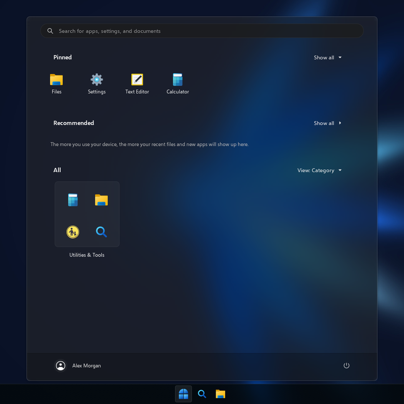
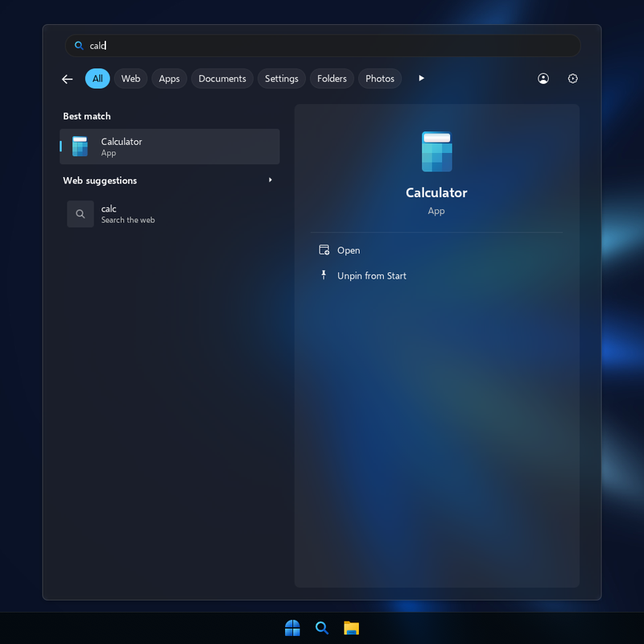
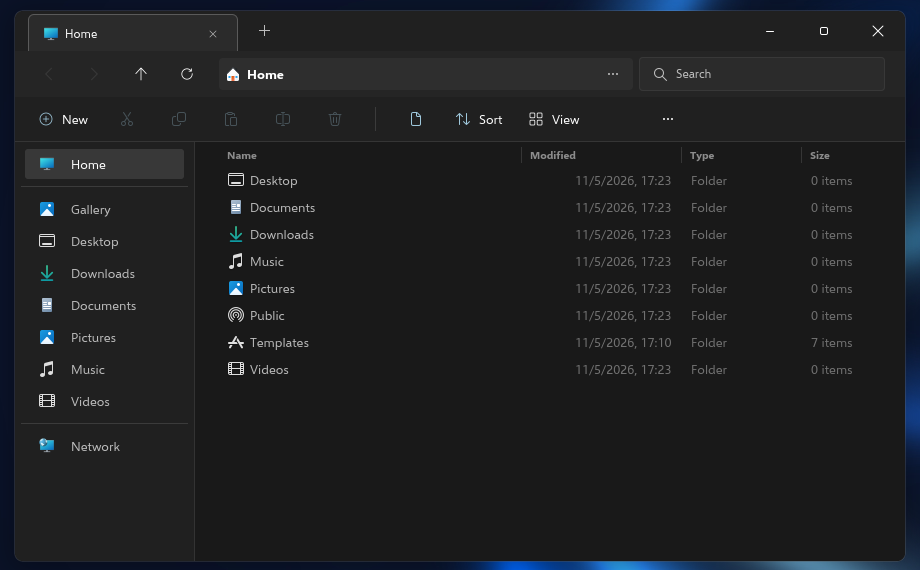
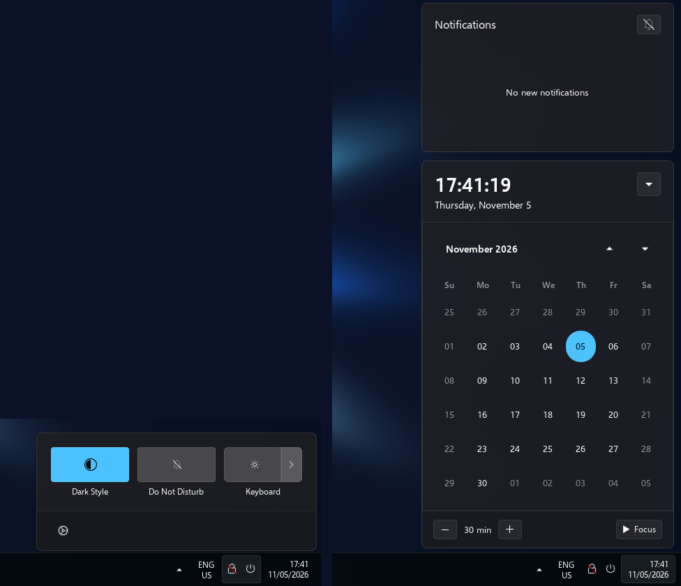
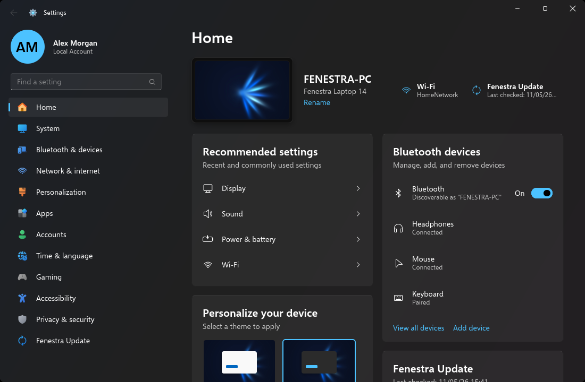
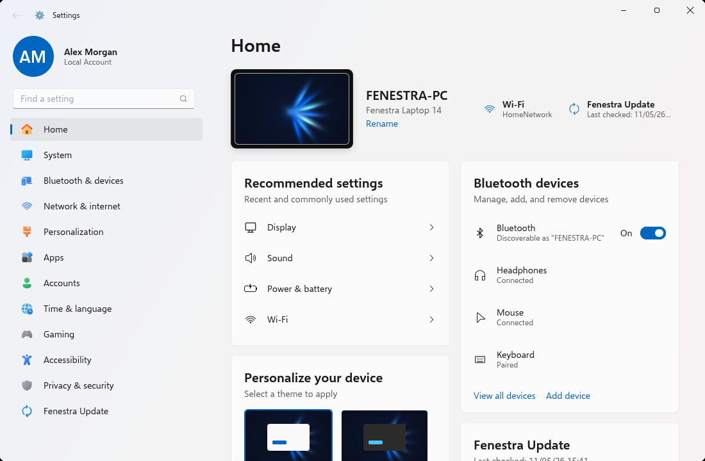
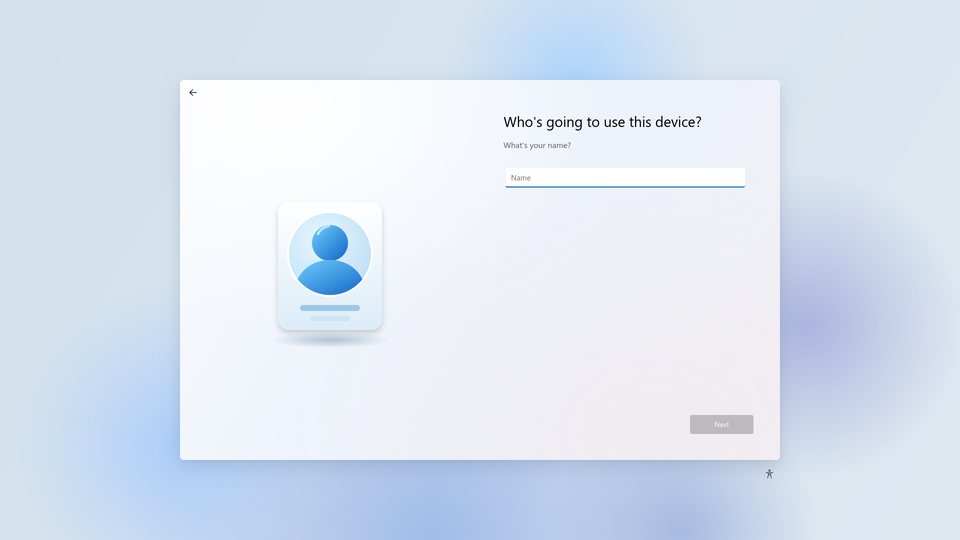
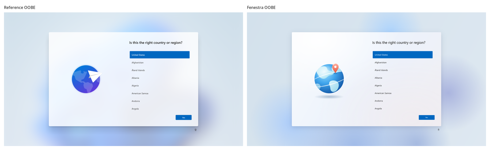
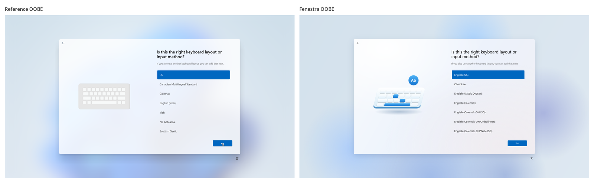
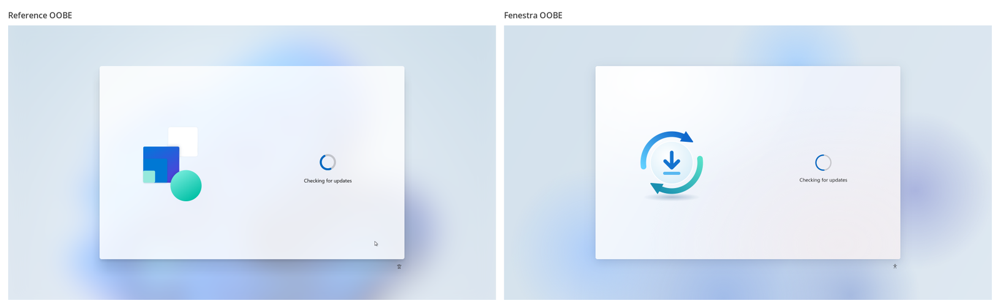

<p align="center">
  <picture>
    <source media="(prefers-color-scheme: dark)" srcset="docs/images/wordmark-dark.png">
    <source media="(prefers-color-scheme: light)" srcset="docs/images/wordmark-light.png">
    
  </picture>
</p>

<p align="center"><b>A Fedora-based Linux distribution that looks and works like Windows 11.</b><br>
Taskbar, Start, Search, File Explorer, Settings and first-boot setup — rebuilt on GNOME, open source.</p>

<p align="center">
  
</p>

---

Fenestra is a **Fedora 43 remix**. It installs Fedora Workstation and layers a complete
Windows-11-style desktop on top of GNOME 49. It uses no Wine and no theming tricks that break on
update: just GNOME Shell extensions, an Explorer layer for Files, and two apps written from scratch,
**Fenestra Settings** and the **Fenestra first-boot setup (OOBE)**.

> Fenestra is not affiliated with Microsoft and contains no Microsoft files (see
> [THIRD-PARTY.md](THIRD-PARTY.md)). If you dual-boot, `fenestra-import-windows-assets` can copy
> *your own* Windows fonts and cursors into your home folder for a pixel-identical look.

## Gallery

| Start | Search |
|---|---|
|  |  |

| File Explorer | Quick settings, notifications and calendar |
|---|---|
|  |  |

| Settings (dark) | Settings (light) |
|---|---|
|  |  |

**First-boot setup (OOBE)**

| Region | Account | Privacy | Finale |
|---|---|---|---|
|  |  |  |  |

Desktop screenshots come from a headless GNOME Shell with the Fenestra overlay installed
(`tests/shell/shell.sh`); OOBE and Settings screenshots come from their built-in screenshot modes
with demo data. No personal data is shown.

### Windows 11 ↔ Fenestra

Reference (Windows 11 25H2 OOBE, left) and Fenestra (right). Geometry, type sizes, colours and
buttons are matched; the illustrations are Fenestra's own.





## What you get

| Area | Windows 11 behaviour reproduced |
|---|---|
| **Taskbar** | Centred icons, acrylic dark bar, press-shrink animation, live window previews with blur, Show desktop corner, Windows tray layout (overflow ^, language, Wi‑Fi/volume/battery, clock + date) |
| **Start** | Search box, Pinned grid, Recommended files, *All* apps by category / grid / list, account and power flyouts, Windows motion (slides up from the taskbar) and a **luminosity acrylic** effect |
| **Search** | Separate Search flyout: recent searches, filter chips (All · Web · Apps · Documents · Settings · Folders · Photos), *Best match* column and a preview pane with Open/Pin actions |
| **Quick settings / calendar** | Windows-style quick settings tiles, media flyout, notification centre, calendar with Focus timer |
| **Notifications** | Windows toast banners, Snipping-Tool-style screenshot toast |
| **File Explorer** | Files (Nautilus) with the Explorer sidebar (Home, Gallery, Desktop, Downloads … Network), command bar (New, cut/copy/paste/rename/delete, Sort, View), tabs, view modes (Extra large icons … Details/Tiles/Content), **New ▸** menu with document templates |
| **Desktop** | Desktop icons with the same right-click menu and folder icons |
| **Lock and sign-in** | Windows lock-screen clock, Spotlight-style backgrounds, single-account sign-in screen |
| **Consent prompts** | Administrator prompts styled like User Account Control (password always required) |
| **Settings** | New Settings app modelled on Windows 11 Settings (System, Bluetooth & devices, Network, Personalization, Apps, Accounts, Time & language, Gaming, Accessibility, Privacy, Update) |
| **First boot** | Windows-11-style OOBE: region, keyboard, network, device name, account, automatic sign-in, privacy, “Hi… this might take a few minutes” |
| **Installer** | Anaconda with the Fenestra name and artwork (no Fedora logos); account screens hidden because the OOBE creates the user |
| **Look** | Fluent-based dark GTK theme with the default Windows blue accent, Win11 icon theme, Bibata Original cursors, Selawik (Segoe UI metrics) and Cascadia fonts, original Fenestra wallpapers |

## Install

1. Download `Fenestra-43-netinst-x86_64.iso` from the [Releases](../../releases), or the
   `Fenestra-43-netinst-x86_64` artifact of the latest [CI run](../../actions), or build it (below).
2. Write it to a USB stick (Fedora Media Writer, Ventoy, `dd` …) and boot it.
3. Pick the disk in the installer; everything else is preconfigured. Packages come from the Fedora
   mirrors, so an internet connection is required.
4. After the reboot, the Windows-style setup asks for region, keyboard, network, device name and
   your account, then signs you in.

## Build it yourself

Requirements: Fedora (any recent version), `podman`, `python3-pillow`, `python3-numpy`,
ImageMagick, `librsvg2-tools`, `cpio`, `git`, `curl`. No root needed.

```bash
git clone https://github.com/miguelcoxcaballero/fenestra-os && cd fenestra-os
```

```bash
curl -L --create-dirs -o ~/.local/share/fenestra-vm/Fedora-Everything-netinst-x86_64-43-1.6.iso \
  https://dl.fedoraproject.org/pub/fedora/linux/releases/43/Everything/x86_64/iso/Fedora-Everything-netinst-x86_64-43-1.6.iso
```

```bash
bash build/build-iso.sh    # -> build/out/Fenestra-43-netinst-x86_64.iso
```

`python3 tools/generate-assets.py` regenerates the open assets (already committed).
`bash build/build-overlay.sh` builds just the file tree Fenestra adds on top of Fedora.

Rootless builds cannot rebuild the EFI boot image, so they boot the kickstart in BIOS mode only;
the CI build (`.github/workflows/build-iso.yml`, runs as root) produces a UEFI-ready ISO.

## Test it

**Virtual machine.** `build/build-iso.sh --test` builds an unattended ISO that **wipes the disk**
(VMs only) and allows root SSH with `~/.local/share/fenestra-vm/test_key`:

```bash
bash build/build-iso.sh --test
```

```bash
bash tests/vm/vm.sh install build/out/Fenestra-43-test-x86_64.iso
```

```bash
bash tests/vm/vm.sh boot
```

`tests/vm/vm.sh shot NAME`, `key`, `type`, `click X Y` and `ssh CMD` drive the VM (QMP
screenshots go to `tests/vm/shots/`). It uses KVM when available and falls back to TCG.
`FENESTRA_MIRROR=http://mirrors.kernel.org/fedora` pins one HTTP mirror for networks that
intercept TLS. `tests/vm/win11.sh` runs a Windows 11 Enterprise Evaluation VM for reference shots.

**Headless shell (no VM).** In a Fedora 43 container with the overlay installed,
`tests/shell/shell.sh start | shot | click | key | eval | run` runs GNOME Shell headless with all
Fenestra extensions, for quick screenshots and JS error checks. The apps have their own headless
screenshot modes (see [apps/fenestra-settings](apps/fenestra-settings) and
[apps/fenestra-oobe](apps/fenestra-oobe)).

## Repository layout

```
apps/fenestra-settings/   Windows-11-style Settings app (Python + GTK 4)
apps/fenestra-oobe/       Windows-11-style first-boot setup (replaces GNOME Initial Setup)
desktop/extensions/       GNOME Shell extensions (Fenestra's own + modified ArcMenu/DING + upstream ones)
desktop/nautilus/         Explorer layer for Files: nautilus-python extensions + UI overlay
desktop/dconf/            System-wide defaults (/etc/dconf/db/local.d, gdm.d)
desktop/themes/           Fenestra-Dark GTK theme
desktop/skel/             New-user files (GTK overrides, "New" templates)
assets/generated/         Open assets: battery, power, menu icons, folders, wallpapers, logo
kickstart/                Anaconda kickstarts (installer + unattended test)
build/                    build-overlay.sh, build-iso.sh, installer branding
tools/                    Asset generator, icon theme builder, dconf exporter, Windows asset importer
tests/vm/, tests/shell/   QEMU harness (QMP screenshots/input) and headless GNOME Shell harness
docs/                     Images and the test report
```

## How it fits together

* **Shell**: Dash to Panel (taskbar) + ArcMenu (Start and Search) + `fenestra-tray` (tray, quick
  settings, calendar, previews, press animation, toasts) + Blur my Shell, Rounded Window Corners,
  Tiling Assistant (Snap layouts), DING (desktop).
* **First boot**: GDM starts its initial-setup session when no user exists; Fenestra's systemd
  drop-ins run `fenestra-oobe` instead of GNOME Initial Setup, which creates the account and
  signs in automatically.
* **Assets** are looked up in `~/.local/share/fenestra/assets` first (imported originals) and then
  in `/usr/share/fenestra/assets` (open defaults), so importing never touches system files.
* **Files** keeps the stock Nautilus package: `fenestra-patch-nautilus` derives a copy with
  Explorer sidebar icon names at boot, and `fenestra-nautilus` only uses it (plus the UI overlay)
  when it matches the installed major version; otherwise stock Nautilus runs.
* **Defaults** live in dconf system databases; users can change everything.

## Status

Fenestra is an early community project. The latest test report, with what was verified, how,
and the known issues, is in [docs/TESTING.md](docs/TESTING.md).

## Licence

GPL-3.0-or-later for Fenestra's code; bundled components keep their own licences
([THIRD-PARTY.md](THIRD-PARTY.md)).

---

### En español

Fenestra OS es una distribución basada en **Fedora 43** que reproduce Windows 11: barra de tareas
centrada, menú Inicio, Búsqueda, Explorador de archivos, Configuración y la instalación inicial
(OOBE), todo sobre GNOME 49 y sin archivos de Microsoft. Descarga la ISO, arráncala, elige el disco
y, tras reiniciar, el asistente al estilo Windows te pide región, teclado, red, nombre del equipo y
tu cuenta. Para compilarla: `bash build/build-iso.sh` (instrucciones arriba). Si tienes Windows en
el mismo equipo, `fenestra-import-windows-assets` copia tus propias fuentes Segoe UI y cursores
para que se vea idéntico. El estado de las pruebas está en [docs/TESTING.md](docs/TESTING.md).
