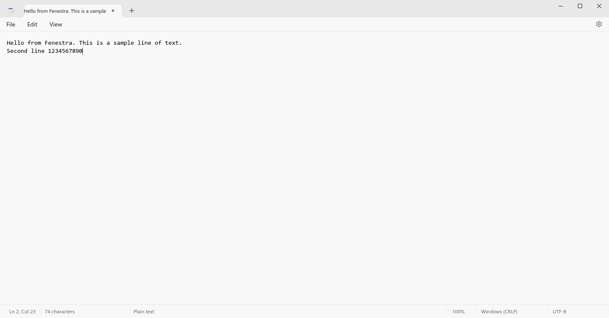
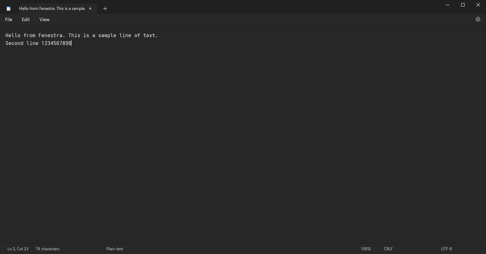
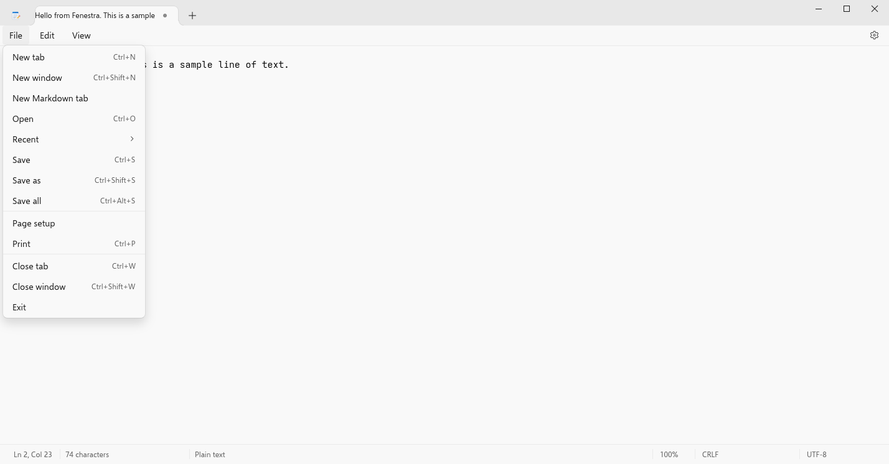
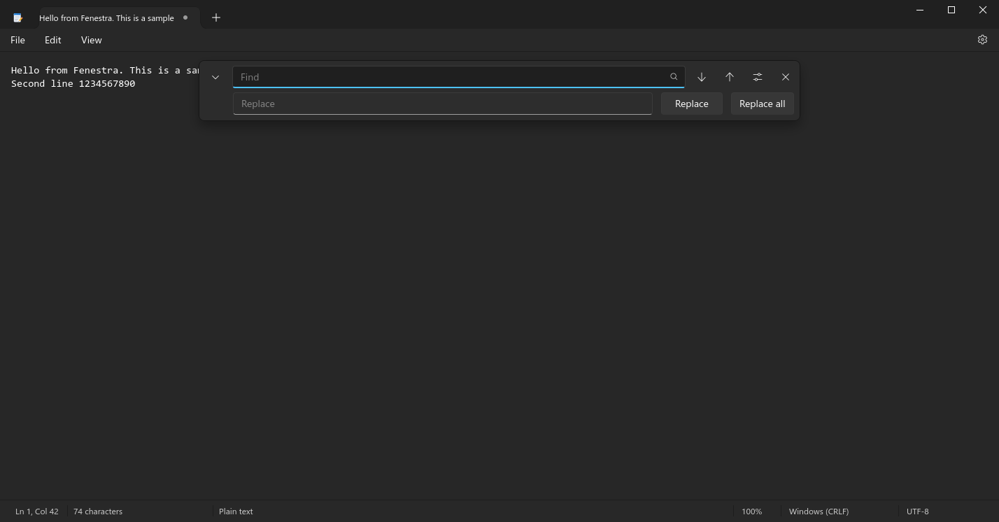
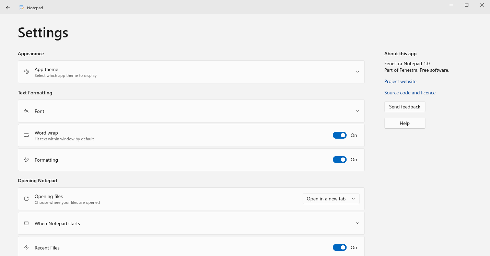
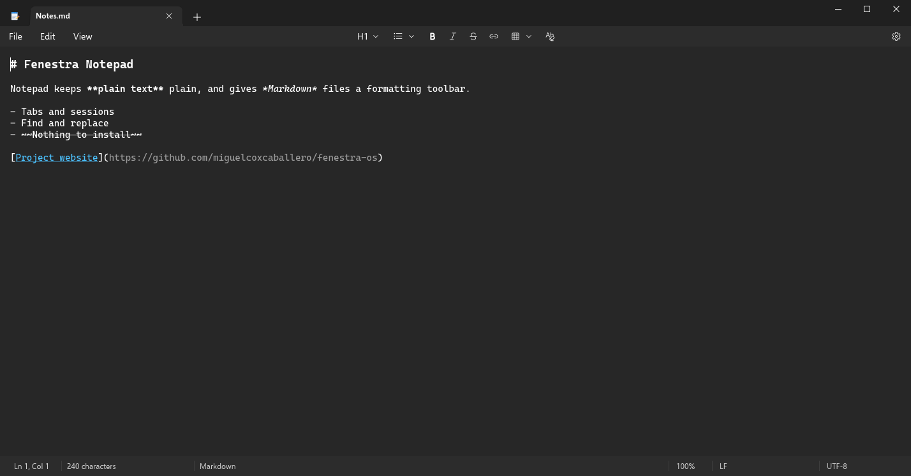
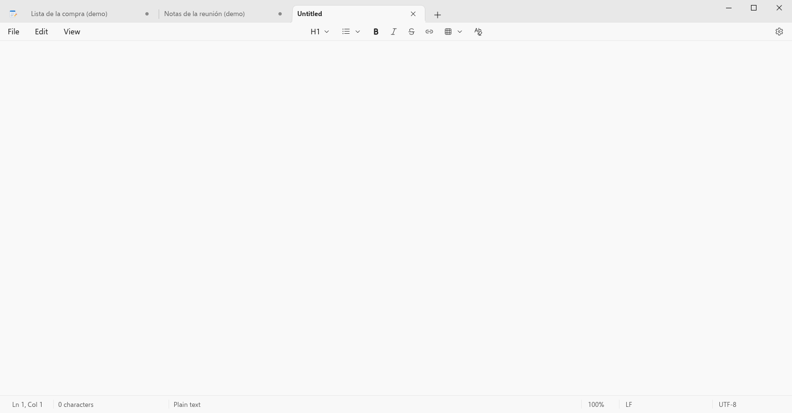
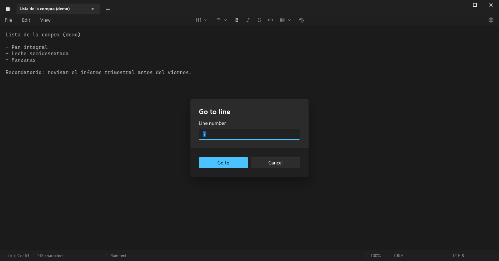

# Fenestra Notepad

A from-scratch **Notepad** for Fenestra (Fedora 43 / GNOME 49) that looks and behaves like
the current Windows 11 Notepad: tabs in the title bar with the unsaved-changes dot, File /
Edit / View menu bar, Markdown formatting toolbar, floating Find / Replace
card, status bar (position, characters, format, zoom, line ending, encoding), Settings page
and session restore. It replaces GNOME Text Editor as the default text editor.

Python 3 + PyGObject + **GTK 4** + **GtkSourceView 5** (no libadwaita, no pip dependencies).

| Light | Dark |
|---|---|
|  |  |
|  |  |
|  |  |
|  |  |

Every state is in [`screenshots/`](screenshots/).

## Running

```sh
cd apps/fenestra-notepad
./bin/fenestra-notepad [FILE...]                 # or: python3 -m fenestra_notepad
./bin/fenestra-notepad --new-window notes.txt
FENESTRA_NOTEPAD_LANG=es ./bin/fenestra-notepad  # Spanish (follows LANG by default)
```

Single instance (`org.fenestra.Notepad`): launching it again opens the files as new tabs of
the running window (or in a new window, see *Settings > Opening files*).

## What it does

* **Tabs** – `+` / Ctrl+N, Ctrl+W, Ctrl+Tab / Ctrl+Shift+Tab, Ctrl+PageUp/Down, Ctrl+1…9,
  middle-click closes; untitled tabs are named after their first line; a dot marks unsaved
  changes. Opening a file replaces the single empty "Untitled" tab, like Windows. Files can
  be dropped on the window. Closing the last tab closes the window.
* **File** – New tab, New window (Ctrl+Shift+N), New Markdown tab, Open (Ctrl+O, several
  files at once), Recent, Save (Ctrl+S), Save as (Ctrl+Shift+S), Save all (Ctrl+Alt+S),
  Page setup, Print (Ctrl+P, `Gtk.PrintOperation` + `GtkSource.PrintCompositor`, with
  header and page numbers), Close tab, Close window (Ctrl+Shift+W), Exit.
* **Edit** – Undo (Ctrl+Z; redo with Ctrl+Y / Ctrl+Shift+Z), Cut, Copy, Paste, Delete,
  Clear formatting (Markdown tabs), Find (Ctrl+F), Find next (F3), Find previous (Shift+F3),
  Replace (Ctrl+H), Go to (Ctrl+G), Select all, Time/Date (F5), Font (opens Settings).
* **View** – Zoom in / out / restore (Ctrl+Plus, Ctrl+Minus, Ctrl+0, Ctrl+wheel; per tab,
  10–500 %), Status bar, Word wrap.
* **Find / Replace card** – incremental search, Enter / Shift+Enter, options: Match case,
  Wrap around; Replace and Replace all (one undo step).
* **Context menu** – Cut / Copy / Paste / Select all / Delete row, Undo, and for Markdown
  tabs Insert table / Insert link. Menu key and Shift+F10 open it at the cursor.
* **Encodings** – detected on open: UTF-8, UTF-8 with BOM, UTF-16 LE / BE (with or without
  BOM), fallback ISO-8859-1. **Line endings** – first line break decides: `CRLF`,
  `LF`, `CR`. Both are kept when saving; click them in the status bar to
  convert. Text that does not fit ISO-8859-1 is saved as UTF-8 instead of being lost.
  Saving is atomic (temporary file + rename) and keeps the file mode.
* **Large files** – the file is read and decoded in a worker thread and inserted in
  512 KiB chunks at a priority just below redraw: a 20 MB file opens in about half a second
  with the UI never blocked for more than ~40 ms. Files over 512 MB are refused.
* **Markdown** – `.md` files (or *New Markdown tab*, or the *Plain text / Markdown* switch in
  the status bar) get the formatting toolbar: headings 1–6 / body text, bulleted and
  numbered lists, bold (Ctrl+B), italic (Ctrl+I), strikethrough, link (Ctrl+K), table picker,
  clear formatting. Markdown is shown as styled syntax (bold, italic, larger headings,
  struck-through text, links). As in Windows the toolbar is shown on every tab while
  *Formatting* is on; using it on a plain-text tab turns that tab into a Markdown one.
* **Settings** (gear) – App theme (Light / Dark / Use system setting), Font (family, style,
  size, preview), Word wrap, Formatting, Opening files (new tab / new window), When Notepad
  starts (continue previous session / start new session), Recent Files, About.
  Stored in `~/.config/fenestra-notepad/settings.json`.
* **Session restore** – with *Continue previous session* (default) closing the last window
  never prompts: every window, tab, cursor position and zoom, plus the text of unsaved and
  modified tabs, is kept in `~/.local/state/fenestra-notepad/` (also saved 1.5 s after
  edits and on SIGTERM / logout). Closing a single tab, or any window while others stay
  open, asks *Save / Don't save / Cancel* like Windows. With *Start new session* every
  close prompts and nothing is restored.
* **Theme** – follows `org.gnome.desktop.interface color-scheme` and the accent colour
  (`org.fenestra.desktop accent-color-custom`, else GNOME `accent-color`) live.
  The window has square corners (the shell rounds them).

## Tests

```sh
# headless compositor only (never the real desktop)
~/.local/bin/fenestra-test-run dbus-run-session -- mutter --headless --wayland --no-x11 \
    --virtual-monitor 1920x1080 --wayland-display=fenestra-test &
export WAYLAND_DISPLAY=fenestra-test GDK_BACKEND=wayland
python3 tools/smoke-test.py          # ~150 checks: encodings, EOLs, save bytes, find/replace,
                                     # go to, menus, Markdown, settings, print to PDF,
                                     # 20 MB file responsiveness, session restore
python3 tools/check_translations.py  # every _() string has a Spanish translation
tools/screenshots.sh                 # regenerate screenshots/
```

`--screenshot OUT.png [--shot STATE] [--dark|--light] [--lang es]` renders a state
(`main`, `menu-file`, `menu-edit`, `menu-view`, `menu-zoom`, `menu-recent`, `context`, `find`,
`replace`, `settings`, `settings-font`, `markdown`, `tabs`, `save`, `goto`, plus the reference
states `text`, `empty`, `find-typed`, `find-options`, `settings-theme`) with demo text and never reads
or writes the user's settings or session. `FENESTRA_SHOT_DEBUG=1` also prints the window-relative
box of every styled widget, for measuring against reference captures.

## Install

```sh
PREFIX=$HOME/.local ./install.sh           # per user
DESTDIR=/tmp/pkg PREFIX=/usr ./install.sh  # packaging
```

Installs `bin/fenestra-notepad`, `share/fenestra-notepad/`, the desktop entry
`org.fenestra.Notepad.desktop` (text/plain and common text/code MIME types) and the icon.
Runtime dependencies: `python3-gobject`, `gtk4`, `gtksourceview5`.

## Differences from Windows Notepad

* No Copilot, *Define with Bing*, spelling, account or "What's new" features.
* Markdown is shown as styled source text (markers stay visible) rather than a fully
  rendered rich-text view; *View > Markdown* is therefore omitted.
* Page setup and the print dialog are the GTK ones; Open / Save as use the GTK file chooser
  (encodings are changed from the status bar instead of the Save dialog).
* Fonts: Segoe UI / Consolas are used when installed, otherwise Selawik / Inter and
  Cascadia Mono / Liberation Mono / DejaVu Sans Mono.
* NUL bytes in a file are shown (and saved) as `␀`.

## Licences

Code: same licence as Fenestra. UI icons in `data/icons/ui` come from Fluent UI System
Icons (MIT, see `LICENSES/`), regenerated with `tools/gen-icons.py`. The application icon
is original artwork (CC0).
