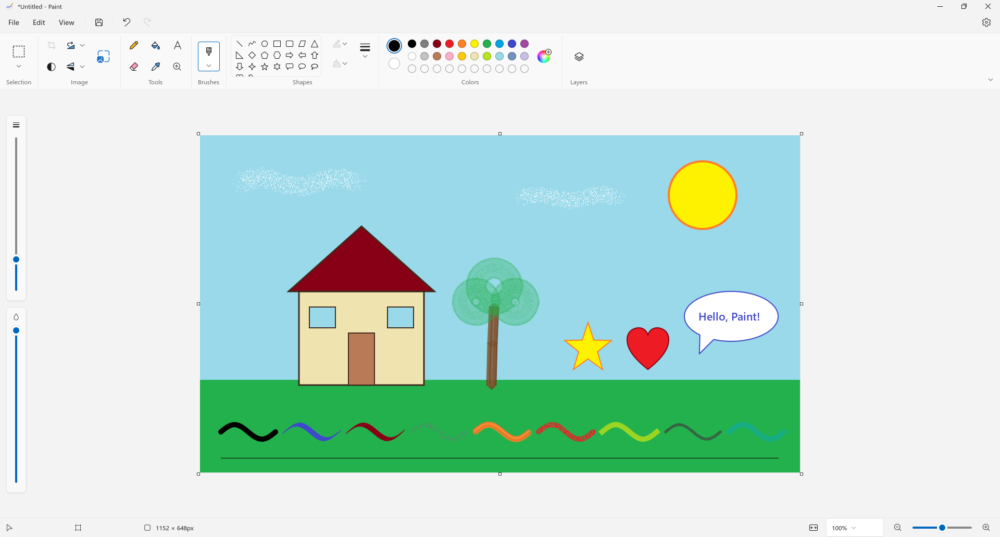
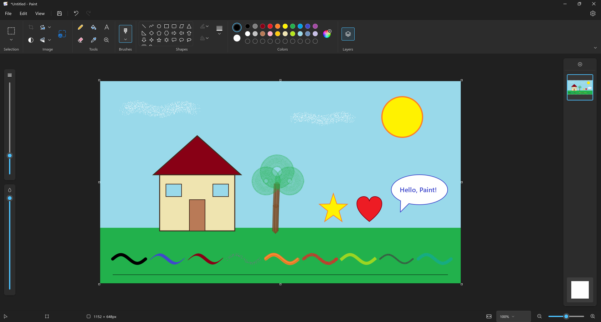

# Fenestra Paint

A from-scratch **Paint** for Fenestra (Fedora 43 / GNOME 49) that looks and works like the
current Windows 11 Paint: menu bar with File / Edit / View, the toolbar with Selection,
Image, Tools, Brushes, Shapes, Colors and Layers, the floating size and opacity sliders,
a canvas with resize handles, a layers panel, the settings page and a live status bar.

Python 3 + PyGObject + **GTK 4** + cairo. No libadwaita, no pip dependencies (numpy is not
needed: pixel work uses C-speed `bytes` operations).

| Light | Dark |
|---|---|
|  |  |

All screenshots are in [`screenshots/`](screenshots/) (menus, dialogs, settings, Spanish UI).

## Running

```sh
cd apps/fenestra-paint
./bin/fenestra-paint [image ...]          # or: python3 -m fenestra_paint
FENESTRA_PAINT_LANG=es ./bin/fenestra-paint   # Spanish (follows LANG by default)
```

Install: `PREFIX=$HOME/.local ./install.sh` (per user) or `DESTDIR=/tmp/pkg PREFIX=/usr ./install.sh`
(packaging). The desktop entry (`org.fenestra.Paint.desktop`, *Paint* / *Image Editor*) offers
the app in "Open with" for PNG, JPEG, BMP, GIF, WebP and TIFF without making it the default.

## Features

* **Selection** – rectangle and free-form; move (drag or arrow keys), resize with handles,
  Ctrl+drag stamps a copy, cut / copy / paste, delete, select all, invert selection,
  transparent selection (colour 2 becomes transparent), crop to selection.  Rotate, flip,
  resize/skew and invert colours apply to the selection when there is one.
* **Image** – crop, rotate right/left/180°/custom angle, flip vertical/horizontal,
  *Resize and skew* dialog (percentage or pixels, aspect ratio, skew degrees), invert
  colours (in the slot where Windows has the AI "remove background", which is omitted).
* **Tools** – pencil (aliased), fill bucket (scanline flood fill: 40–80 ms for a full-HD fill),
  text (font, size, bold, italic, underline, strikethrough, alignment, background fill,
  movable/resizable box, IME input), eraser, colour picker (left = colour 1, right =
  colour 2), magnifier (left zoom in, right zoom out).
* **Brushes** – brush, calligraphy brush (45° nib, tapers with speed), calligraphy pen,
  airbrush (spray that keeps building while held), oil brush (bristles, paint runs out),
  crayon and natural pencil (paper grain), marker (even translucency, no overlap
  darkening), watercolour (translucent wash with darker rim).
* **Shapes** – the 23 shapes of the gallery (line, curve with two bends, oval, rectangles,
  polygon, triangles, diamond, pentagon, hexagon, arrows, stars, callouts, heart,
  lightning); outline and fill styles (none, solid, crayon, marker, oil, natural pencil,
  watercolour); the shape stays editable (move, 8 handles, Shift keeps proportions) until
  committed; colour/size/style changes apply to the shape being edited.
* **Colours** – colour 1 / colour 2 (left / right mouse button), the 20-colour palette, 10
  custom colours (GTK colour dialog, remembered), size and opacity sliders.
* **Layers** – add, delete, duplicate, hide/show, move up/down (also drag and drop),
  merge down, per-layer opacity, hideable background (transparent canvas).
* **Undo/redo** – Ctrl+Z / Ctrl+Y; paint operations store zlib-packed patches of the
  touched rectangle, structural ones packed snapshots; bounded to 192 MB / 100 steps.
* **View** – zoom 12.5–800 % (Ctrl+wheel around the pointer, slider, presets, fit to window),
  rulers, gridlines, status bar, always show / automatically hide toolbar, full screen
  (F11), thumbnail.
* **File** – New, Open (png, jpg, bmp, gif, webp, tiff, ico, avif), Import to canvas,
  Recent, Save, Save as PNG / JPEG / BMP / GIF (own LZW encoder) / TIFF / WebP, Print and
  Page setup, Set as desktop background (Fill / Tile / Center; both `picture-uri` and
  `picture-uri-dark`), Image properties (units, black and white, size), Exit.  Unsaved
  changes ask *Save / Don't save / Cancel*.  Paste images from the clipboard, drop files
  or images on the window.
* **Settings** – app theme (light / dark / system) and About.  Light/dark and the accent
  colour (GNOME accent or Fenestra's `org.fenestra.desktop accent-color-custom`) follow
  the system live.

Omitted on purpose: Copilot / Cocreator / generative features, "Save as project", Share
and the Microsoft account button.

### Shortcuts

Ctrl+N/O/S, Ctrl+Shift+S (save as PNG), Ctrl+P, Ctrl+E (properties), Ctrl+W (resize),
Ctrl+Z/Y, Ctrl+X/C/V, Ctrl+Shift+C (copy visible layers), Ctrl+A, Delete,
Ctrl+Shift+X (crop), Ctrl+Shift+I (invert colours), Ctrl+Shift+N (new layer), Ctrl+R
(rulers), Ctrl+G (gridlines), Ctrl+Plus/Minus/PgUp/PgDn (zoom), Ctrl+0 (fit), Ctrl+1
(100 %), F11, Esc (commit / deselect), arrows move a selection, Ctrl+B/I/U in a text box.

## How it is built

* `document.py` – layers, background, cached composite (re-rendered only in damaged
  rectangles; while a tool works the layers below/above the active one are flattened
  once), undo history.
* `canvas.py` – the composite is shown as 256×256 GPU textures, only damaged tiles are
  re-uploaded; the GPU scales (nearest when zoomed in).  Cairo overlays are only created
  where something is drawn.  A brush stroke on a 1920×1080 canvas keeps 60 fps
  (~0.6 ms of Python per motion event).
* `tools.py`, `brushes.py`, `shapes.py` – tools draw into their own surfaces and preview
  through the document, then commit one undoable patch.
* `raster.py` – flood fill, colour keying, black-and-white, conversions to/from
  GdkTexture/GdkPixbuf (C-speed `bytes.translate`, big-int arithmetic, `bytes.find`).
* Menus and dialogs are drawn inside the window (WinUI-style flyouts and content dialogs).

Icons: Microsoft Fluent UI System Icons (MIT, see `LICENSES/`), regenerated with
`tools/gen-icons.py`; the shape glyphs, selection rectangle, colour wheel and the app icon
are original drawings.

## Tests

Run only on the headless test compositor, never on a real session:

```sh
~/.local/bin/fenestra-test-run mutter --headless --wayland --no-x11 \
    --virtual-monitor 1920x1080 --wayland-display=fenestra-test &
env -u DISPLAY WAYLAND_DISPLAY=fenestra-test GDK_BACKEND=wayland GSETTINGS_BACKEND=memory \
    ~/.local/bin/fenestra-test-run python3 tools/smoke-test.py   # ~190 checks
python3 tests/check_translations.py                              # every UI string in es
tools/screenshots.sh                                             # regenerate screenshots/
```

The smoke test drives every tool, brush, shape, outline/fill style, selection operation,
image operation, layer operation, undo/redo, menus and submenus, dialogs, view options,
keyboard shortcuts, IME text input, canvas gestures and resize handles, the unsaved-changes
dialog and saving/reloading in every format, and measures stroke and flood-fill speed.
It uses temporary XDG directories and the in-memory GSettings backend, so it never touches
the user's configuration or desktop background.
