# Fenestra Settings

A from-scratch settings app for **Fenestra** (Fedora 43 / GNOME 49) that looks and
behaves like a modern Fluent-style settings app: left navigation pane with a user
card and search, grouped setting cards, toggle switches with On/Off labels,
breadcrumb titles, and short slide/fade page transitions.

Written in Python 3 + PyGObject + **GTK 4** (no libadwaita, no pip dependencies).

| Dark | Light |
|------|-------|
| 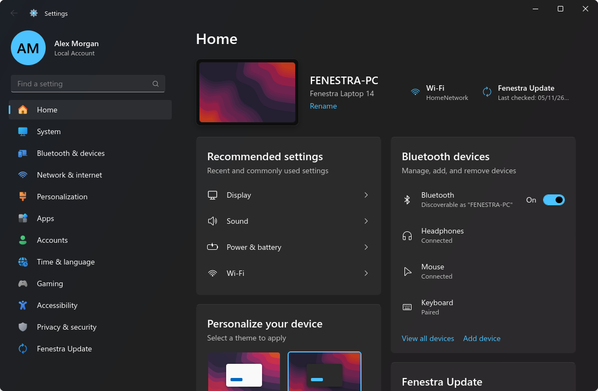 | 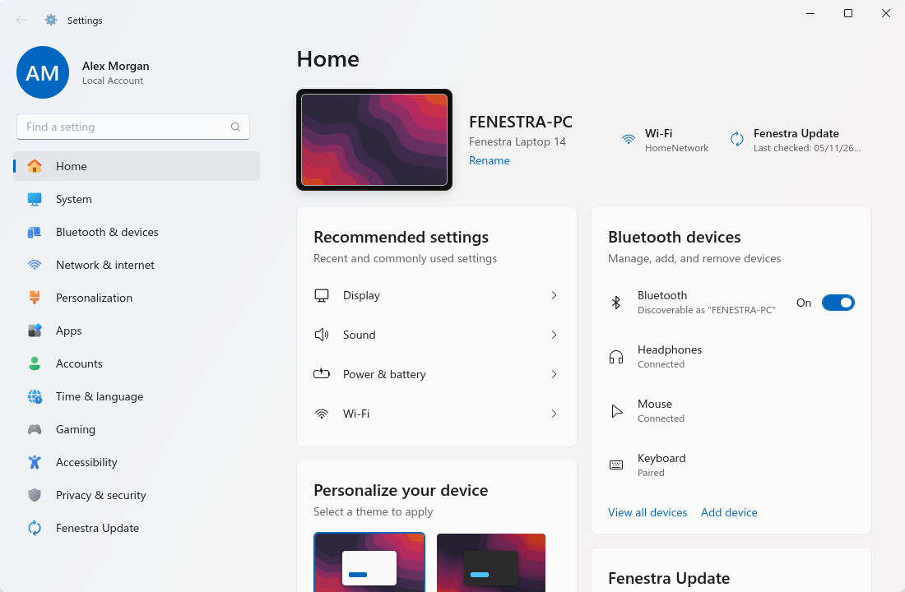 |
| 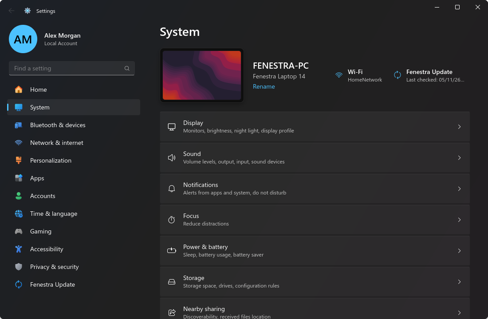 | 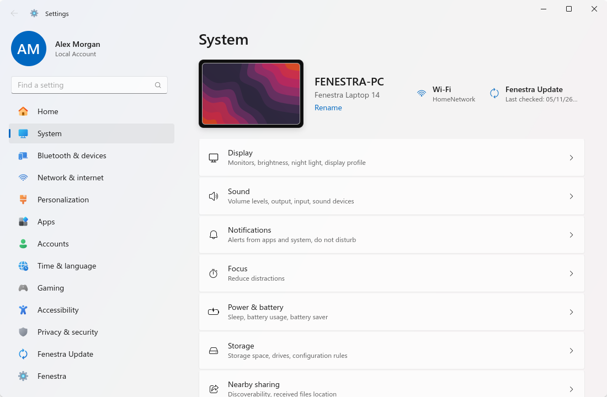 |
| 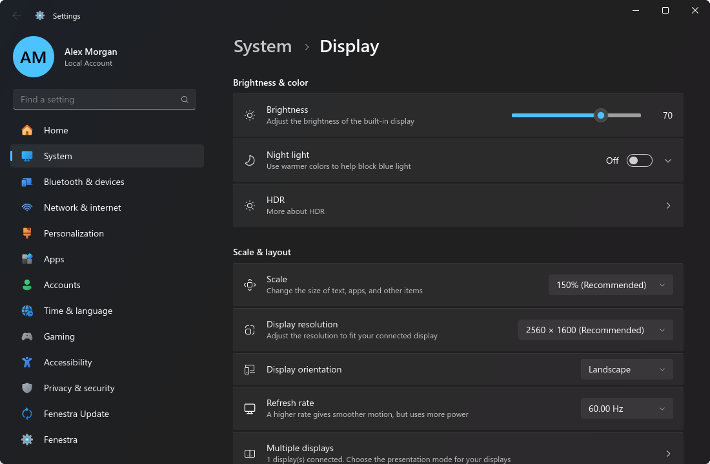 | 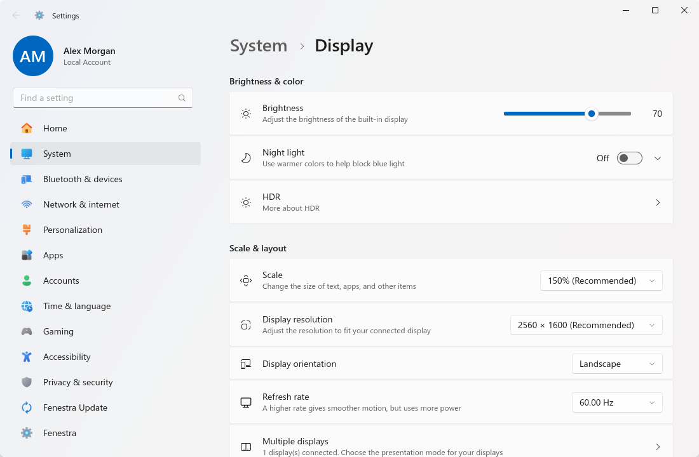 |
| 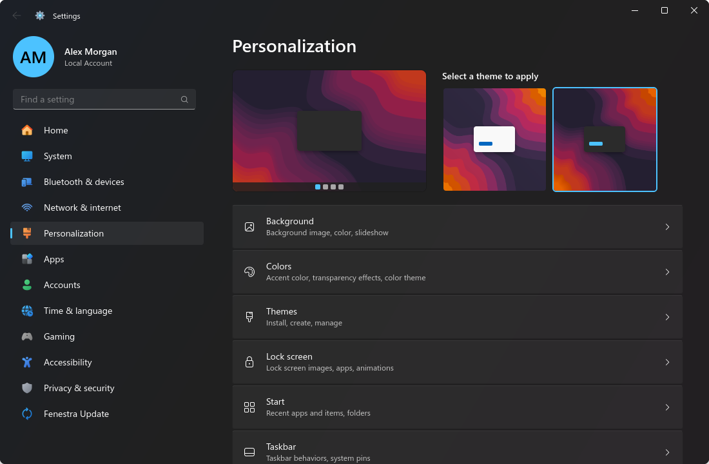 | 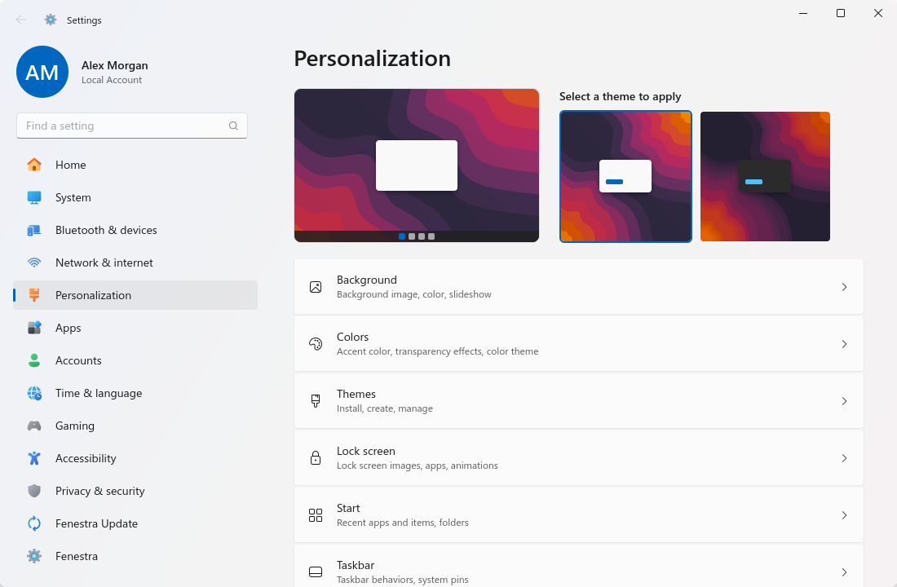 |
| 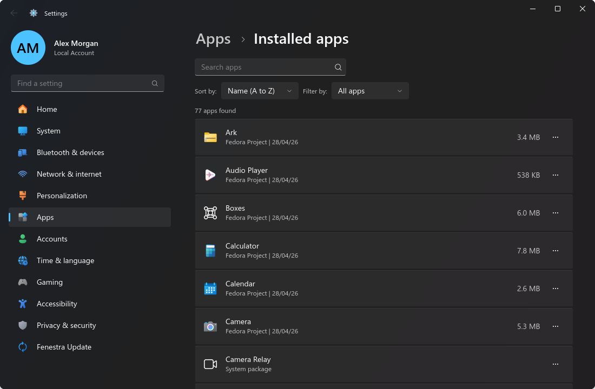 | 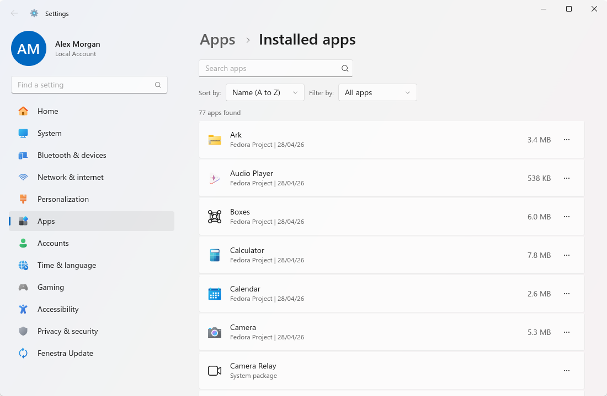 |
| 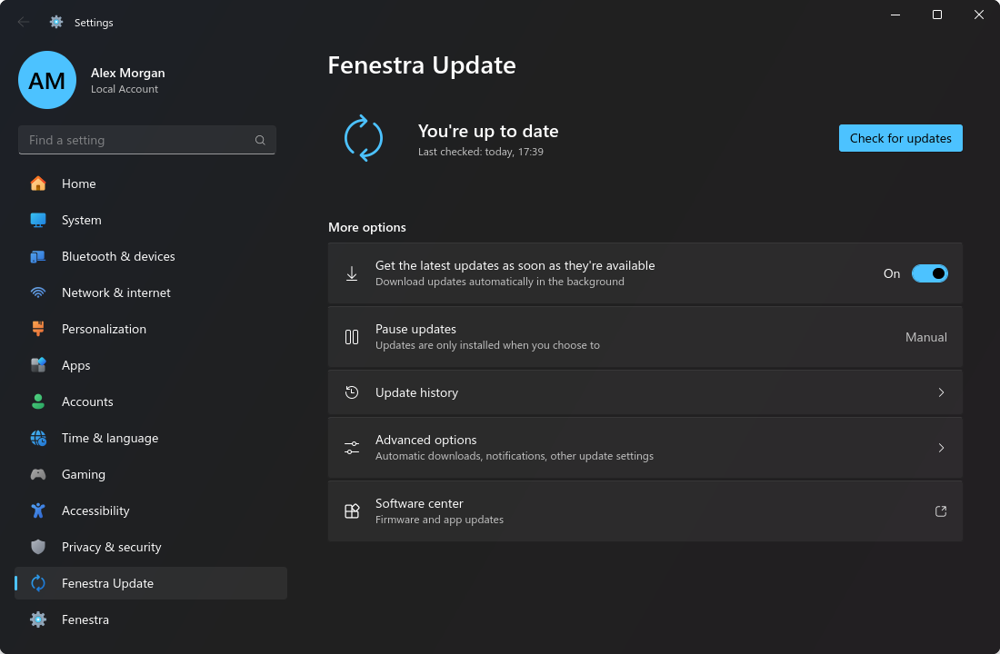 | 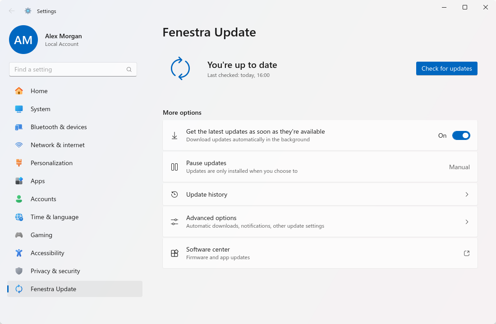 |
| 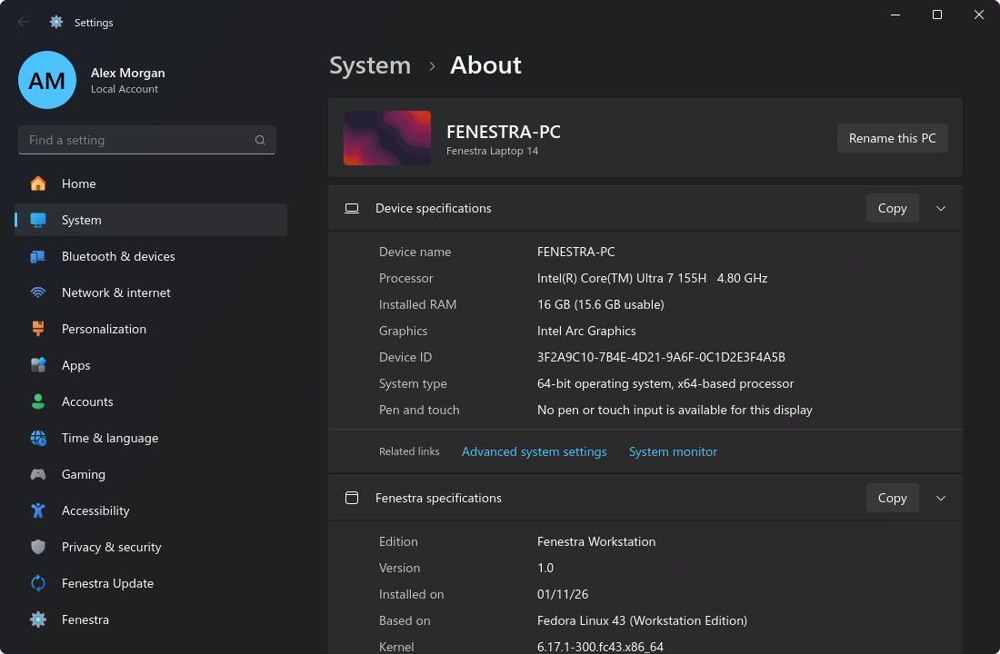 | 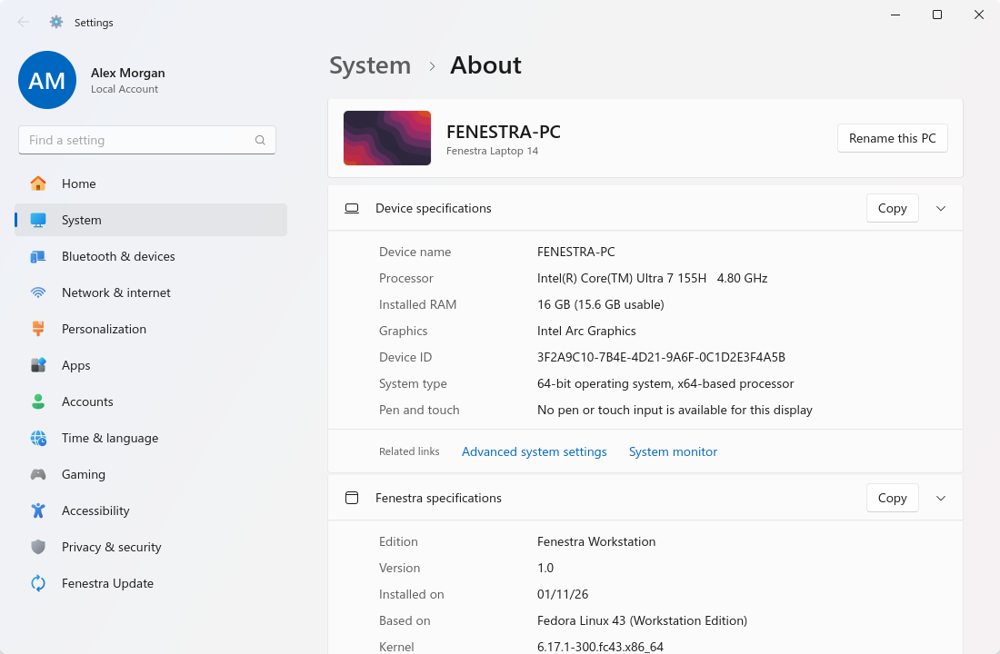 |

More screenshots of every top-level page are in [`screenshots/`](screenshots/).

## Running

```sh
cd apps/fenestra-settings
python3 -m fenestra_settings                 # open Home
python3 -m fenestra_settings --page display  # open a page directly
./bin/fenestra-settings --page bluetooth     # aliases work too
python3 -m fenestra_settings --list-pages    # print every page id
python3 -m fenestra_settings --read-only     # never change anything
python3 -m fenestra_settings --demo-data     # neutral sample data (no personal info)
FENESTRA_SETTINGS_LANG=es python3 -m fenestra_settings   # force Spanish
```

The UI language follows `LANG`/`LANGUAGE` (English default, Spanish `es` included).

### Screenshot / test mode

```sh
python3 -m fenestra_settings --screenshot out.png --page about --dark --size 1100x720
```

Opens the window, waits for layout (`FENESTRA_SHOT_DELAY`, ms, default 1500), renders
it with `Gtk.WidgetPaintable` → `Gsk.GLRenderer.render_texture()` → PNG and quits.
Screenshot mode implies `--demo-data`: every backend returns neutral sample data
(user "Alex Morgan", device "FENESTRA-PC" / "Fenestra Laptop 14", Wi‑Fi "HomeNetwork",
Bluetooth "Headphones"/"Mouse"/"Keyboard", a stock wallpaper, generic storage numbers)
so published screenshots never contain personal information. `--demo-data` can also be
used on its own (it implies `--read-only`). Screenshot mode is **read-only**: every write path (GSettings, D-Bus calls, mutating
commands, launching other programs) is refused. `--dark/--light` only override the
app's own palette; they never touch the system color scheme. `--search TEXT` types
into the search box before capturing.

Tip: run tests against a nested/headless compositor, e.g.
`WAYLAND_DISPLAY=fenestra-test GDK_BACKEND=wayland python3 -m fenestra_settings --screenshot …`.

## Replacing GNOME Settings

`install.sh` also installs (unless `REPLACE_GNOME_SETTINGS=0`):

* `gnome-control-center` wrapper (in `$PREFIX/bin`, or `/usr/local/bin` for `PREFIX=/usr`, both
  ahead of `/usr/bin` in `PATH`): `gnome-control-center <panel>` opens the matching Fenestra page
  (`fenestra-settings --resolve-page <panel>`); unknown panels, `--real` or `FENESTRA_REAL_GCC=1`
  run the real GNOME Settings.
* `org.gnome.Settings.desktop` override (`Exec=fenestra-settings`, `NoDisplay=true`, no
  `DBusActivatable`), so the quick-settings gear, Start menu pins and notification links open
  Fenestra Settings.

The app icon defaults to Fenestra's own gear. `tools/fenestra-import-windows-assets` can copy the
user's own Settings logo from a Windows partition into `~/.local/share/icons/hicolor` (never into
the repo); screenshot/demo mode always uses the bundled icon.

## GNOME and Fenestra sessions

Settings runs in the GNOME Shell session and in the Fenestra session (KWin + Fenestra Shell,
`XDG_CURRENT_DESKTOP=Fenestra`). `fenestra_settings/backends/session.py` decides, in one place,
which pages and rows exist: under Fenestra every control that only GNOME Shell, Mutter or
gnome-settings-daemon would read is hidden (pages, rows, links and search results), never left
as a dead switch. Appearance, taskbar/Start options and do not disturb go through
`backends/appearance`, `backends/shell_options` and `backends/notifications`, which write
`~/.config/fenestra/shell.conf` (read live by the shell) under Fenestra and the GNOME keys
otherwise. Both sessions regenerate the GTK accent theme; `--sync-appearance` does that from
the command line. See `docs/fenestra-shell/APPS.md` §9.

```sh
XDG_CURRENT_DESKTOP=Fenestra python3 -m fenestra_settings --list-pages   # pages shown under Fenestra
```

## Tests

```sh
# every toggle/dropdown/slider on every page, isolated keyfile GSettings, D-Bus sandboxed;
# run it once per session (XDG_CURRENT_DESKTOP=GNOME and XDG_CURRENT_DESKTOP=Fenestra)
WAYLAND_DISPLAY=fenestra-test GDK_BACKEND=wayland python3 tests/control_audit.py --out /tmp/audit.md
python3 tests/check_translations.py   # every UI string has a Spanish translation
python3 tools/test_session_backends.py  # session split + shell.conf writes, temporary HOME
```

## Installing

```sh
./install.sh                              # PREFIX=/usr by default (needs root)
DESTDIR=/tmp/pkgroot PREFIX=/usr ./install.sh   # staged install for packaging
```

Installs the package to `$PREFIX/share/fenestra-settings`, the launcher to
`$PREFIX/bin/fenestra-settings`, `fenestra-settings.desktop` (Name=Settings) and the
`fenestra-settings` icon in hicolor.

## Features

**Real, working settings** (everything slow runs asynchronously via `Gio.Subprocess`
or async D-Bus; missing backends show a "Not available" row instead of failing):

- **Home** – device hero (wallpaper thumbnail, hostname, model, Rename), recommended
  settings, Bluetooth devices with on/off, theme thumbnails + color mode, update status.
- **System** – Display (brightness through gsd-power or mutter `Backlight`, night light
  + strength/schedule, monitor info), Sound (`wpctl` output/input selection, volume,
  mute, alert sounds, over-amplification), Notifications (do not disturb, lock-screen
  notifications, per-app toggles), Focus (timer that enables DND), Power & battery
  (UPower battery, power profiles, screen-off / sleep timeouts, power button), Storage
  (per-volume usage, home-folder breakdown, temporary-file cleanup with confirmation),
  Multitasking (edge tiling, workspaces, Alt+Tab, hot corner), Clipboard, Recovery
  (reboot to firmware), About (hostname, CPU, RAM, GPU via `lspci`, OS info from
  `/etc/os-release`, Copy, Rename via hostnamed).
- **Bluetooth & devices** – BlueZ over D-Bus (power, connect/disconnect, remove, scan
  & pair via `bluetoothctl`), Mouse, Touchpad, Cameras, AutoPlay.
- **Network & internet** – status hero, airplane mode (gsd-rfkill), Ethernet details, and
  Wi‑Fi as Windows 11 through libnm (`NetworkManager-libnm`): live list of available
  networks with inline connect (security key, user name/password, hidden networks,
  "Connect automatically", connecting / wrong key / can't connect states, cancel,
  disconnect), Manage known networks (search, sort, forget, Add a new network), per-network
  properties (connect automatically, metered, random hardware address, view security key,
  IP/DNS summary, properties with Copy) and Hardware properties.
  Tests: `tests/test_wifi_backend.py` and `tests/wifi_ui_flows.py` run against
  `tests/mock_networkmanager.py` on a private bus (never the real NetworkManager).
- **Personalization** – Background (gallery of `/usr/share/backgrounds`, Browse photos,
  fit), Colors (light/dark, accent grid writing `accent-color`), Themes (GTK/icon/cursor
  themes), Lock screen, Start (ArcMenu prefs), Taskbar (Dash to Panel prefs, clock
  options), Fonts (interface fonts, smoothing, hinting, font gallery).
- **Apps** – Installed apps (search, sort, filter, sizes/dates from rpm/flatpak,
  Uninstall via `pkcon remove` / `flatpak uninstall` with confirmation dialog), Default
  apps, Startup apps (`~/.config/autostart` overrides).
- **Accounts** – Your info (avatar via AccountsService `SetIconFile`, full name),
  Sign-in options with **Fenestra Hello**, Other users.
  - *Facial recognition* uses [Howdy](https://github.com/boltgolt/howdy): set up / improve
    recognition (`pkexec howdy add`), remove (`howdy clear`), and "automatically dismiss the
    lock screen" (`howdy set no_confirmation`). The setup wizard shows a live IR-camera preview
    (GStreamer `v4l2src` → `gtk4paintablesink`) and a progress ring while Howdy captures the model.
  - *Fingerprint recognition* talks to fprintd over D-Bus (`Claim`, `EnrollStart`,
    `EnrollStatus`, `DeleteEnrolledFingers2`, `Release`); the wizard fills an original vector
    fingerprint stage by stage (`num-enroll-stages`) and switches to "touch the edges" at 60 %.
  - Wizard states can be rendered with `--screenshot out.png --page signin --hello-demo STATE`
    (`welcome`, `welcome-finger`, `face-1`, `face-2`, `face-done`, `finger-1`, `finger-2`,
    `finger-edges`, `finger-done`, `error`); see `screenshots/hello-*.png`.
- **Time & language** – automatic time (timedated `SetNTP`), searchable time-zone list
  (`SetTimezone`), clock format, regional format (localed), keyboard layouts.
- **Gaming** – Game Mode toggle (`gamemoded` user service) + launchers.
- **Accessibility** – text size (100–225 % with preview and Apply), visual effects,
  pointer size, magnifier, high contrast, screen reader, on-screen keyboard, sticky /
  slow / toggle keys, visual bell.
- **Privacy & security** – screen lock, recent files, trash/temp cleanup, location,
  camera, microphone, diagnostics (ABRT).
- **Fenestra Update** – Check for updates (`pkcon refresh` + `pkcon get-updates`, plus
  Flatpak), update list, Download & install (`pkcon update --only-download` +
  `pkcon offline-trigger`), Restart now, last-checked time, Advanced options, history
  (`dnf history`).
- **Fenestra** (last item in the navigation) – Linux-only settings, rendered natively:
  Workspaces, Window behavior (focus mode, title-bar actions/buttons), Desktop icons (DING),
  Extensions (enable/disable via `org.gnome.Shell.Extensions`, open their settings), Search
  providers (enable/disable/order), Online accounts (GOA list/remove; "Add account" opens GNOME's
  sign-in dialog), Sharing (RDP via `grdctl`, file sharing via `gnome-user-share`), Keyboard
  shortcuts (editable), Printers/tablets/color (read-only info) and "Advanced (GNOME Settings)".
- **Personalization › Start / Taskbar** – native ArcMenu (layout, recommended items, pinned apps
  reset) and Dash to Panel (alignment, position, size, auto-hide, combine buttons, show-desktop
  corner, transparency) controls; extension schemas are loaded from the extension folders.
- **Search** – every page and indexed row (title + English and translated keywords);
  picking a result navigates there, expands the containing card and highlights the row.

**Delegated to GNOME tools** (rows marked with an "open" arrow): advanced display
layout/resolution changes, printers, VPN/proxy/hotspot, password changes and adding
users, online accounts, keyboard shortcuts, pen tablets, per-app permissions.

## Architecture

```
fenestra_settings/
  app.py          Gtk.Application, CLI, screenshot renderer, page aliases
  window.py       title bar, nav + content layout, breadcrumb, transitions, dialogs, toasts
  nav.py          user card, "Find a setting" search box + results popover, category list
  widgets.py      SettingRow, ExpanderRow, Group, ToggleSwitch, Dropdown, Slider, ContentDialog…
  theme.py        light/dark palette + accent → CSS custom properties
  search.py       search index over pages and rows
  i18n.py         gettext-style _() with per-language dictionaries (locale/es.py)
  util.py         read-only guard, async subprocess, GSettings and D-Bus helpers
  backends/       accounts, apps, audio, bluetooth, network, packages, power,
                  storage, system_info, timedate
  pages/          one module per area; each Page registers id, parent, title,
                  keywords and searchable rows
data/
  style.css                      Fluent stylesheet (uses runtime CSS variables)
  icons/fluent/                  icons from Fluent UI System Icons (MIT) + recolored nav icons
  icons/hicolor/…/fenestra-settings.svg   original app icon
  fenestra-settings.desktop
```

Styles are loaded above the user's `gtk.css` priority so the app looks the same
regardless of the installed GTK theme.

## Licenses

- Icons in `data/icons/fluent/` come from Microsoft's
  [Fluent UI System Icons](https://github.com/microsoft/fluentui-system-icons)
  (MIT, see `LICENSES/fluentui-system-icons-MIT.txt`); navigation icons are recolored
  versions of those glyphs.
- The app icon is an original design.
- No proprietary fonts or images are shipped; the CSS only *prefers* Segoe UI Variable
  if it is installed locally, then falls back to Selawik / Inter / sans-serif.
