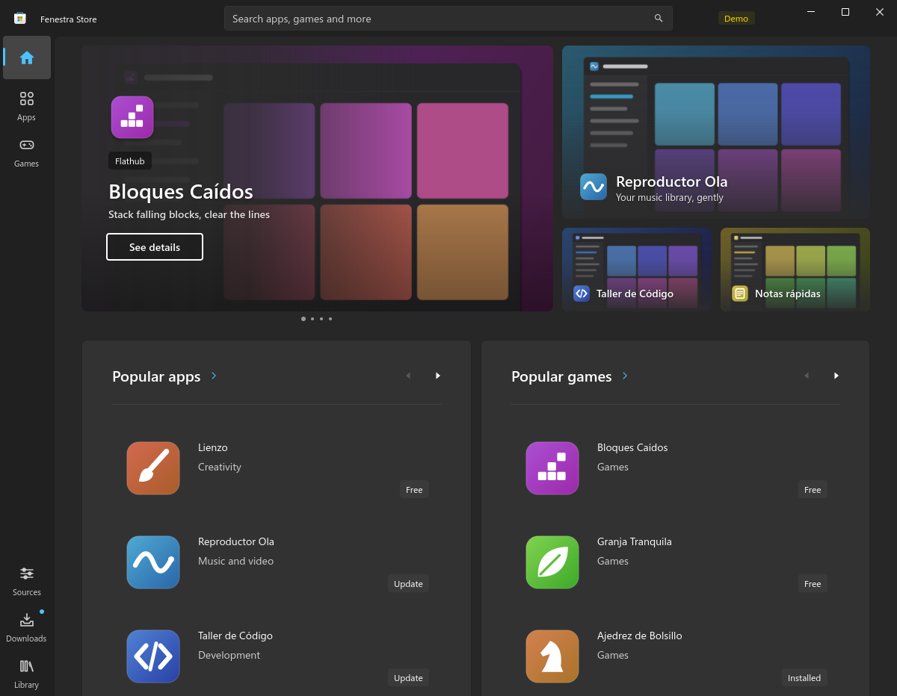
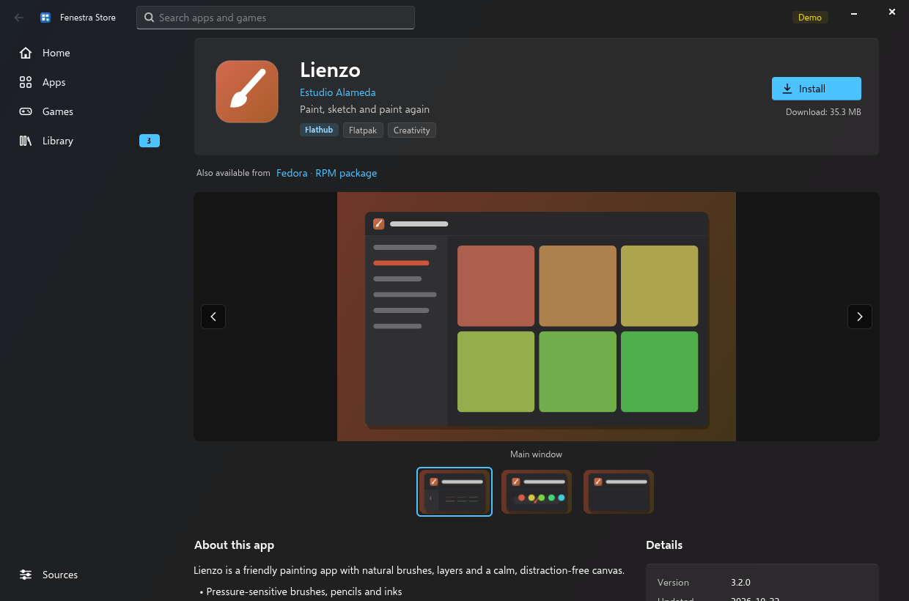
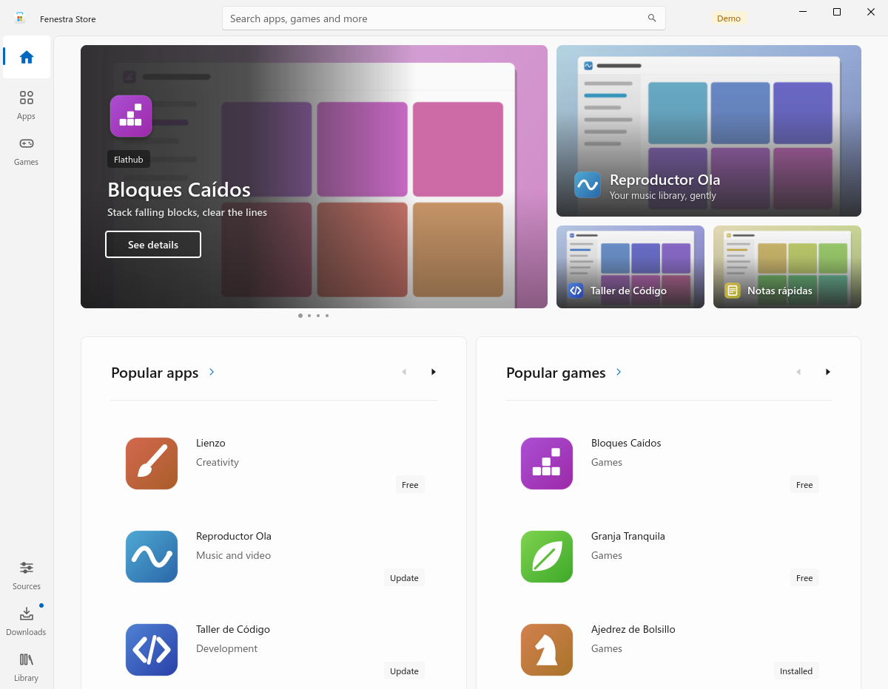
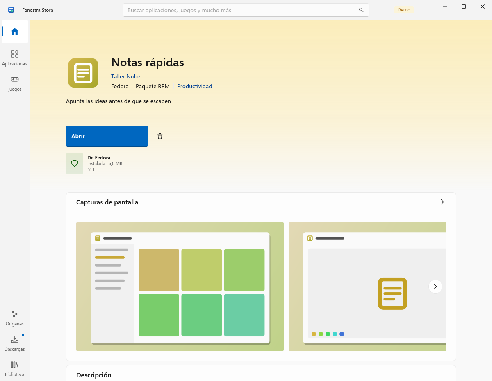
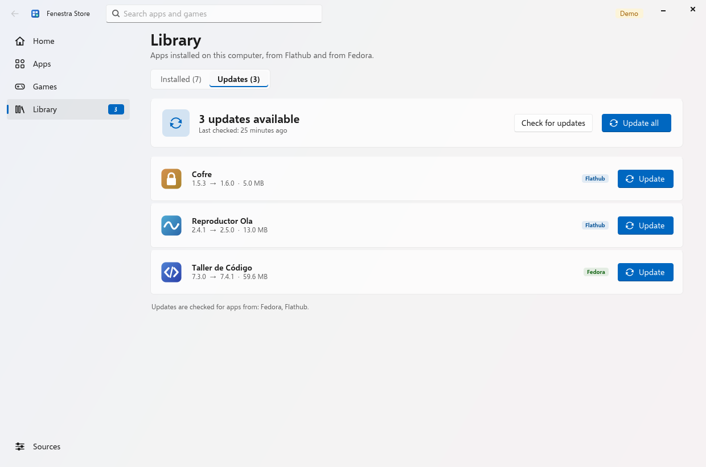
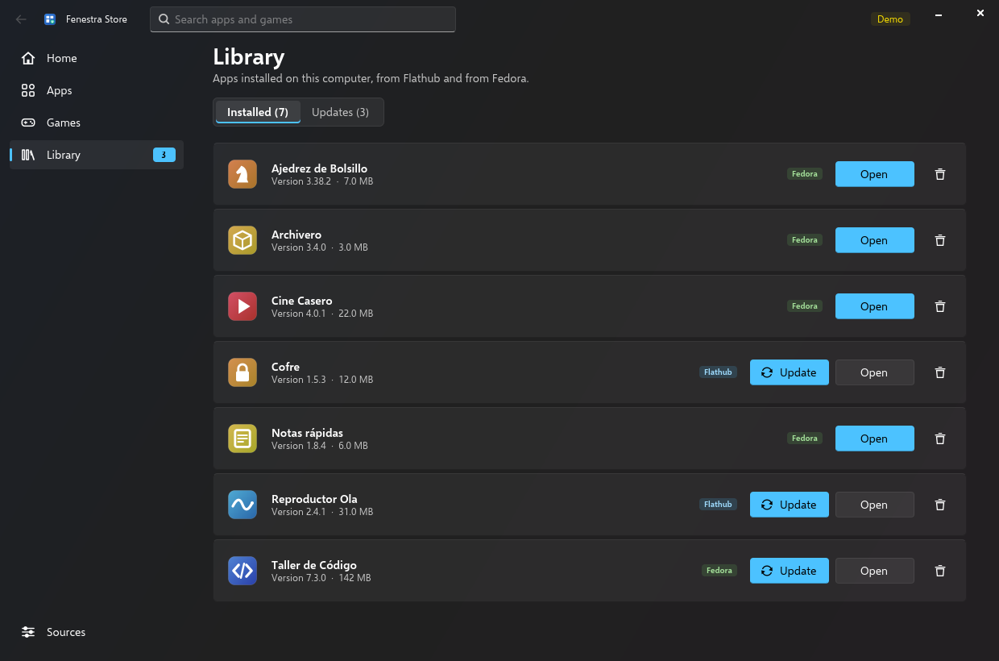

# Fenestra Store

Fenestra's app store. You can browse, search, install, update and uninstall apps from
**Flathub** (Flatpak) and the **Fedora repositories** (RPM, through PackageKit), all in one
catalogue, plus **web apps** for services that have no Linux app (YouTube, WhatsApp, Netflix…).

It is the system's only store: it reads exactly what Fedora's Software (GNOME Software) reads,
and the launchers of GNOME Software and KDE Discover open Fenestra Store instead (see
[One store](#one-store-fenestra-store-is-fedoras-software)).

It is written in Python 3 + PyGObject + **GTK 4** (no libadwaita, no pip dependencies) and
follows the geometry of the reference store, measured at 100 % (design/reference/
measurements.json, key `app_store`, on the visual/reference branch): a 48 px title bar with
the search box centred, a 72 px rail of icon-over-label items, the page in a framed area with
an 8 px corner, a hero of one large and three small tiles, panels that list apps three at a
time, 341x316 result cards and 72 px download rows. It uses the accent colour from GSettings. The layout, artwork and wording are Fenestra's own. Demo
mode only shows invented apps with icons and screenshots generated at runtime.

| Home | App page |
|---|---|
|  |  |
|  |  |

| Downloads (updates) | Library |
|---|---|
|  |  |

More pages are in [`screenshots/`](screenshots/): Apps, Games, Sources and live search (Spanish).
Every screenshot uses demo data.

## Running

```sh
cd apps/fenestra-store
./bin/fenestra-store                       # or: python3 -m fenestra_store
./bin/fenestra-store --demo-data           # invented sample catalogue, simulated operations
./bin/fenestra-store --page updates        # home, apps, games, library, updates, sources,
                                           # category:<key>, search:<text>
./bin/fenestra-store --app org.gnome.Maps  # an app page (AppStream id, package name or name)
./bin/fenestra-store --search "photo"      # start with a search
./bin/fenestra-store --read-only           # never install, remove or change sources
./bin/fenestra-store --list-backends       # which backends this machine would use
./bin/fenestra-store app.flatpakref        # also .flatpakrepo, .rpm, flatpak+https:// links
./bin/fenestra-store --set-default         # make it this user's only store (--unset-default undoes it)
FENESTRA_STORE_LANG=es ./bin/fenestra-store
```

The UI language follows the system locale (`LANGUAGE`/`LC_ALL`/`LC_MESSAGES`/`LANG`).
English is the source language and Spanish is in `fenestra_store/locale/es.py`. Use
`--lang en|es` to override it. `--dark`/`--light` override only the app's own palette.

GNOME Software options are accepted too, so existing links can point here unchanged:
`--mode=updates|installed|overview`, `--details=<app id>`, `--search=<text>`, `--search-text=<text>`,
`--install=<app id>` and `--pkgname=<package>` (both open the app page), `--local-filename=<file>`,
`--interaction` (ignored), `appstream://<app id>` and `flatpak+https://` URIs.

Shortcuts: Ctrl+F / Ctrl+K search, Alt+← back, Esc clears the search or closes a dialog.

### Screenshot mode

```sh
python3 -m fenestra_store --screenshot out.png --size 1240x820 --page library --light --lang es
```

Screenshot mode implies `--demo-data`. The catalogue loads synchronously, so the first frame
already shows the page. The window is rendered with `Gtk.WidgetPaintable` and a GL or Cairo
renderer, then saved as a PNG. `FENESTRA_SHOT_DELAY` (ms, default 1500) sets the delay.
`--real-data` uses the real backends for local testing; never publish those screenshots.

## Pages

* **Home / Apps / Games**: a hero with a large rotating banner and three tiles, then pairs of
  panels: Popular apps and games, New and updated, and one panel per category (Apps also has a
  row of category chips). Each row shows the icon, name, category and a chip with the state
  (Free, Installed, Update).
  * **Popular first** (`popular.py`): a curated, ordered list leads Home, Apps and the
    "Popular" panels: Google Chrome, YouTube, Spotify, Brave, Discord, WhatsApp, Telegram, VLC,
    Zoom, Firefox, Edge, OBS, GIMP, LibreOffice, VS Code, Slack, Netflix, Prime Video, Disney+…
    and, for games, Steam, Heroic, Lutris, Prism Launcher… Then the apps GNOME Software itself
    features (its `org.gnome.App-list.xml`), then the most complete listings.
  * **Banners** (`media.py`, `widgets.BannerArt`): each hero tile is the app's real AppStream
    screenshot (the ≥ 1200 px image, cover-cropped) under a gradient of its AppStream branding
    colour, with its icon, name and summary. Images download in two background threads (what
    is on screen first), are scaled once and cached in `~/.cache/fenestra-store/banners`; a
    neutral skeleton shows while they load, and apps without screenshots get their branding
    colour (or their icon's colour) with the icon drawn large. The hero is the popular apps
    that have screenshots.
* **Categories**: sorting (popular or recommended, name, recently updated) and a grid of
  cards (icon, name, source and category, summary, first screenshot) that loads 60 at a time.
* **Search**: the search box is in the title bar. Results are live (150 ms debounce),
  ranked by name, then keywords, summary, developer, id and description. Matching ignores
  accents ("rapidas" finds "Notas rápidas"). Results can be filtered to apps or games.
* **App page**: icon, name, developer (click to search for their apps), summary, source and
  format, Install / Open / Update / Uninstall with real progress, over a gradient of the app's
  colour; then cards with the screenshot strip, the description, details (version, release date, download and installed
  size, licence, source and remote, format, developer, website), permissions for Flatpak
  apps ("not sandboxed" for RPMs), "Other apps by …", and "Also available from" when the same
  app exists in both sources.
  **There are no ratings.** Fenestra Store has no review source yet (ODRS is not wired up),
  and it never invents ratings.
* **Library**: installed apps from both sources as 72 px rows (source, version and size,
  Open/Update, and a menu with Uninstall). **Downloads** (rail) lists the updates: per app or
  *Update all*, progress, *Check for updates*, "last checked", and a dot on the rail item.
* **Sources**: turn Flathub on or off (Flatpak remotes), add Flathub if it is missing, and
  turn the Fedora repositories on or off (PackageKit). The page also explains how apps are
  installed.

## Backends (`fenestra_store/backends/`)

All backends implement the same interface (`Backend`: `load`, `refresh_updates`, `details`,
`install`, `remove`, `update`, `launch`, `sources`, `set_source_enabled`). `choose()` picks
them at runtime. A missing typelib or daemon only disables that backend, and the app still
starts in demo mode with none of them installed.

| Backend | Uses | Catalogue |
|---|---|---|
| `flatpak.py` | `gi` **Flatpak-1.0** (`flatpak-libs`): system and user installations, remotes, `Flatpak.Transaction` with per-operation progress, sizes (`fetch_remote_size_sync`), permissions from the ref metadata (`[Context]`), remote enable/disable (`modify_remote`), adding Flathub (`Remote.new_from_file`) | each enabled remote's AppStream data (`/var/lib/flatpak/appstream/<remote>/<arch>/active/appstream.xml.gz`, cached icons next to it), fetched with `update_appstream_sync` if missing |
| `packagekit.py` | `gi` **PackageKitGlib-1.0** (`PackageKit-glib`): `resolve`, `get_details`, `install_packages` / `remove_packages` / `update_packages` (only trusted) with progress, `refresh_cache` + `get_updates`, `get_repo_list` / `repo_enable` | the system AppStream pool (Fedora's `appstream-data`, `/usr/share/swcatalog`), using only components with a package name |
| `webapps.py` | nothing (pure Python) | Fenestra's popular web apps (YouTube, WhatsApp, Netflix, Prime Video, Disney+) and GNOME Software's web app list (`/usr/share/swcatalog/xml/gnome-pwa-list-*.xml`). Install writes `~/.local/share/applications/org.fenestra.WebApp.<id>.desktop` that opens the site with `--app=URL` in the default browser when it is Chromium-based (else any Chromium-based browser, else a new Firefox window); its icon is the site's own (web manifest, apple-touch-icon or favicon), downloaded at runtime, never shipped |
| `demo.py` | nothing | 28 invented apps in 8 categories (one web app), two from both sources, 7 installed, 3 with updates, deterministic, simulated progress |

`appstream.py` reads catalogues with **gi AppStream-1.0** (`appstream` package; catalog
format style, per-paragraph translations resolved to the UI language) when it is
available. Otherwise it uses a small pure-Python reader for AppStream XML (`.xml` or `.gz`).
Both readers produce the same records. `tools/test-backends.py` checks them against the same
fixture.

Threads: catalogue loading, details, update checks, downloads of remote icons and
screenshots, and every install, remove or update run off the UI thread. Operations go
through one serial job queue (`store.py`). Results and progress go back to the UI with
`GLib.idle_add`, at most about 20 progress updates per second.

Root: the store never runs as root and refuses to start as root unless `--read-only` or
`--demo-data` is set. RPM changes go through the PackageKit daemon, and changes to system
Flatpak installations go through `flatpak-system-helper`. Both ask polkit, which shows the
password prompt when one is needed.

Runtime dependencies: `python3-gobject`, `gtk4`, `python3-cairo`. Optional: `flatpak-libs`
(Flathub), `PackageKit` + `PackageKit-glib` (Fedora RPMs), `appstream` (gi reader) and
`appstream-data` (the Fedora catalogue).

## Tests

```sh
python3 tools/smoke-test.py                 # demo backend end to end, no display needed
WAYLAND_DISPLAY=… python3 tools/smoke-test.py --ui --lang es   # also builds every page
python3 tools/test-backends.py              # AppStream readers, permissions, real backends load
python3 tools/check-translations.py         # every UI string has a Spanish translation
python3 tools/gen-icons.py                  # regenerate data/icons/ui/*.svg
```

* `smoke-test.py` also checks the popular list and how it ranks a catalogue (Chrome, YouTube,
  Spotify first; hero = popular apps with screenshots), the banner loader (one job per image,
  scaled cache, dominant colour, branding colour fallback), web apps (install writes a valid
  launcher, uninstall removes it), the GNOME Software / Discover overrides and the GNOME
  Software command line. `test-backends.py` checks branding colours, the large screenshot,
  .flatpakref/.flatpakrepo parsing and, with the real backends, that the curated apps are
  found and lead the hero.
* `smoke-test.py` loads the catalogue and checks search, accent folding, alternatives,
  developer rows and permissions. It runs install, uninstall, update and Update all with
  progress callbacks, checks for updates and switches Flathub off and on. With `--ui` it
  opens every page and every app page, runs a live search, installs and uninstalls from the
  app page and runs Update all from the Library.
* Headless runs use the `fenestra-kwinlab` image:
  ```sh
  docker run --rm --privileged -v $PWD:/src:ro fenestra-kwinlab bash -c 'export XDG_RUNTIME_DIR=/tmp/x;
    mkdir -p -m700 $XDG_RUNTIME_DIR; dbus-run-session -- bash -c "kwin_wayland --virtual --socket w0 \
    >/dev/null 2>&1 & sleep 3; export WAYLAND_DISPLAY=w0 GSK_RENDERER=cairo; cd /src/apps/fenestra-store;
    python3 -B tools/smoke-test.py --ui --lang es"'
  ```
  Under `kwin_wayland --virtual`, only the window's first frame is presented. That is why
  screenshot mode builds the page before the window is mapped. Images that load later (for
  example screenshots downloaded from Flathub) never appear in a screenshot there.

## Installing

```sh
sudo ./install.sh                          # PREFIX=/usr
PREFIX=$HOME/.local ./install.sh           # per user
DESTDIR=/tmp/pkg PREFIX=/usr ./install.sh  # staging for packaging
```

The script installs `fenestra-store`, `org.fenestra.Store.desktop`, the app icon, the
package under `$PREFIX/share/fenestra-store` (precompiled) and the licence, and makes Fenestra
Store the only visible store (see below; `REPLACE_STORES=0` skips that).

## One store: Fenestra Store is Fedora's Software

**Same machinery, same answers.** GNOME Software has no public API for its catalogue
(libgnome-software is private and has no GObject introspection; its D-Bus interface only opens
windows: `--details`, `--search`, `--mode`). So Fenestra Store reads the very same sources
GNOME Software's plugins read, and the two never disagree:

| | GNOME Software | Fenestra Store |
|---|---|---|
| Fedora RPMs | PackageKit plugin + the OS AppStream catalog (`/usr/share/swcatalog`) | the same: PackageKit-glib + AppStream `Pool` with `LOAD_OS_CATALOG` |
| Flatpak | libflatpak, every enabled remote of the system and user installations, each remote's AppStream | the same (libflatpak via gi, `<remote appstream dir>/appstream.xml.gz`) |
| Installed / updates | PackageKit `GetUpdates`, libflatpak `list_installed_refs_for_update` | the same calls |
| Featured / popular | `org.gnome.App-list.xml` (FeatureTile, `GnomeSoftware::popular`) | read too (after Fenestra's curated list) |
| Web apps | `gnome-pwa-list-*.xml` | read too, plus Fenestra's popular web apps |

Installing in either store is seen by the other at once (it is the same rpmdb and the same
Flatpak installation). GNOME Software stays installed: its D-Bus service and search provider
still work, and anything that talks to `org.gnome.Software` over D-Bus still opens it.

**Only one store is visible** (`fenestra_store/integration.py`, nothing is uninstalled):

* `org.gnome.Software.desktop` and `org.kde.discover.desktop` are overridden by entries of the
  same id that run Fenestra Store and are hidden (`NoDisplay=true`, no `DBusActivatable`), so
  menus and search show only Fenestra Store while pins, "Software" links and
  `gtk-launch org.gnome.Software` open it;
* `gnome-software-local-file-{flatpak,packagekit}.desktop` run
  `fenestra-store --local-filename %f`, so the system defaults for .flatpakref, .flatpakrepo and
  .rpm files open Fenestra Store; Discover's URL, Flatpak and Snap handlers are `Hidden`;
* where: `install.sh` with `PREFIX=/usr` (as `build/build-overlay.sh` runs it for every
  Fenestra install) writes them to `/usr/local/share/applications`, which comes before
  `/usr/share/applications`; a per-user install (`PREFIX=$HOME/.local ./install.sh`) runs
  `fenestra-store --set-default`, which writes them to `~/.local/share/applications` and makes
  Fenestra Store the user's default for `x-scheme-handler/appstream`,
  `x-scheme-handler/flatpak+https`, `application/vnd.flatpak.ref`, `application/vnd.flatpak.repo`,
  `application/x-rpm` and `application/x-redhat-package-manager` (`~/.config/mimeapps.list`).
  `REPLACE_STORES=0` skips all of it; `fenestra-store --unset-default` removes the per-user part.

Still to do outside this folder:

* **Fenestra Settings**: `apps/fenestra-settings/fenestra_settings/pages/apps.py` ("Get
  more apps") and `pages/update.py` ("Software center") launch `["gnome-software"]` and
  `["gnome-software", "--mode=updates"]` through `ext_row`, guarded by
  `util.have("gnome-software")`. Change both to `fenestra-store` (`--mode=updates` works
  as-is, or use `--page updates`) and the guard to `util.have("fenestra-store")`.
* Callers that use GNOME Software's D-Bus service directly (`org.gnome.Software`, e.g. its
  update notifications and search provider) still open GNOME Software.
* `desktop/libexec/fenestra-post-install` could add the MIME defaults above to
  `/etc/xdg/fenestra-mimeapps.list` system-wide (today they reach Fenestra Store through the
  overridden GNOME Software entries the distribution defaults name).

## Files

```
fenestra_store/app.py          command line, Gtk.Application, screenshot mode
fenestra_store/window.py       title bar + search, navigation rail, page stack, dialogs, toasts
fenestra_store/store.py        catalogue merge, ranking, queries, search, serial job queue, local files, signals (no GTK)
fenestra_store/popular.py      curated popular apps and games, GNOME Software's featured list
fenestra_store/media.py        background loader for banners and icons (scaled cache, dominant colour)
fenestra_store/integration.py  launcher overrides for GNOME Software / Discover, default handlers
fenestra_store/model.py        App / Source records, categories, permission texts
fenestra_store/backends/       demo, flatpak, packagekit, webapps, appstream readers
fenestra_store/pages/          home, browse (apps/games/category/search), details, library, sources
fenestra_store/widgets.py      cards, badges, action area with progress, hero banners, carousel, toggles
fenestra_store/art.py          generated icons and screenshots for demo apps (cairo)
fenestra_store/theme.py        light/dark palette and accent (as Fenestra Settings)
fenestra_store/i18n.py, locale/es.py
data/style.css, data/icons/    stylesheet, generated symbolic icons, app icon
tools/                         smoke test, backend tests, translation check, icon generator
```

## Licence

GPL-3.0-or-later (`LICENSES/GPL-3.0-or-later.txt`). All code, icons (`tools/gen-icons.py`,
`org.fenestra.Store.svg`) and generated artwork are original to Fenestra. There is no
third-party code or asset in this folder (web apps' icons are downloaded from each site at
runtime; no trademarked artwork is in the repository). Catalogue data, icons and screenshots shown at
runtime come from the user's configured sources and are not part of the repository.
