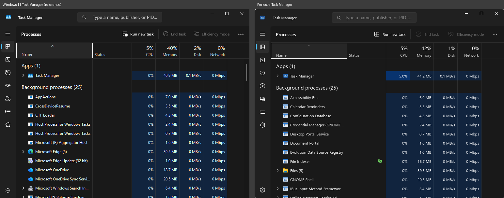
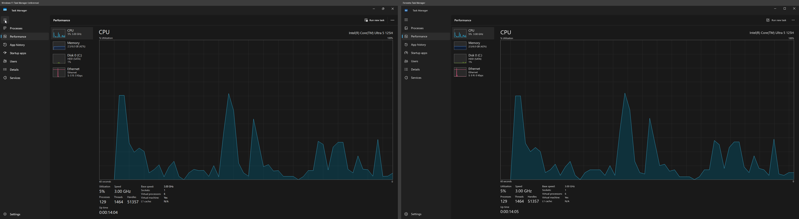

# Fenestra Task Manager

A from-scratch **Task Manager** for Fenestra (Fedora 43 / GNOME 49) that looks and behaves
like the Windows 11 25H2 Task Manager: navigation rail (collapsed or expanded with the
hamburger), search box in the title bar, Processes with *Apps / Background processes /
System processes* groups and heat-map columns, Performance with live 60-second graphs,
App history, Startup apps, Users, Details, Services and Settings.

Python 3 + PyGObject + **GTK 4** (no libadwaita, no pip dependencies, psutil not needed).
All data comes straight from `/proc` and `/sys`.

| Windows 11 (left) vs Fenestra (right) |
|---|
|  |
|  |

Every page is in [`screenshots/`](screenshots/) (`compare-*.png` = side by side with the
Windows 11 captures in `tests/vm/shots/win11/`, the rest = Fenestra only).

## Running

```sh
cd apps/fenestra-taskmgr
./bin/fenestra-taskmgr                          # or: python3 -m fenestra_taskmgr
./bin/fenestra-taskmgr --page performance --perf memory
./bin/fenestra-taskmgr --read-only              # never change anything
FENESTRA_TASKMGR_LANG=es ./bin/fenestra-taskmgr # Spanish (follows LANG by default)
```

Shortcuts: **Ctrl+Shift+Esc** (system-wide, set up by Fenestra), Ctrl+F search,
Ctrl+1…7 pages, Delete = End task, F5 refresh, Menu/Shift+F10 context menu,
←/→ collapse/expand.

## What it does

* **Processes** – GNOME starts every app in a `app-gnome-<desktop-id>-<pid>.scope` cgroup, so
  processes are grouped per application reliably (`GIO_LAUNCHED_DESKTOP_FILE` as fallback).
  Apps = processes of a displayable `.desktop` app; Background processes = other processes of
  real users (grouped by systemd unit, with expanders and counts); System processes = system
  services; all kernel threads are summed into one *System* row.  CPU % = Δ(utime+stime) /
  interval / cores; memory = PSS from `smaps_rollup` (refreshed round-robin) or private
  anonymous RSS from `statm`; disk = Δ`/proc/PID/io`; network per process is not available on
  Linux and shows `0 Mbps` (like idle processes on Windows).  Heat-map shading follows the
  accent colour.
* **End task** – SIGTERM, then SIGKILL after 3 s (whole app scope through `cgroup.kill`);
  other users' processes through `pkexec`.  **Efficiency mode** – nice +10 and idle I/O class
  (green leaf in Status).  Context menu: Expand, End task, Efficiency mode, Go to details,
  Open file location (Files' `ShowItems`), Search online, Properties.  **Run new task** – the
  *Create new task* dialog (commands, paths, URIs, optional `pkexec`).
* **Performance** – CPU (model, speed from cpufreq, sockets/cores/logical, caches,
  virtualization, processes/threads/handles (open files), up time; overall or logical
  processor graphs), Memory (usage graph, composition bar, compressed = zram, committed,
  cached, pools, hardware reserved), every physical disk (active time, transfer rate,
  response time, capacity, system disk, page file, SSD/HDD + bus), Ethernet/Wi‑Fi (throughput
  with auto scale, SSID via nmcli, IPv4/IPv6), GPU when the driver exposes
  `gpu_busy_percent`.
* **App history** – CPU time per app, accumulated in `~/.local/state/fenestra-taskmgr/`.
* **Startup apps** – XDG autostart (`~/.config/autostart` + `/etc/xdg/autostart`); Enable /
  Disable writes a user copy with `Hidden=`.  Last BIOS time from systemd's firmware timestamps.
* **Users** – per-user totals with their apps nested.
* **Details** – one row per process (PID, status, user, CPU, memory, architecture,
  description), sortable, End task / End process tree.
* **Services** – `systemctl list-units --type=service --all` for system and user units;
  Start / Stop / Restart through systemctl (polkit asks for authentication).
* **Settings** – theme, default start page, update speed (High 0.5 s / Normal 1 s /
  Low 4 s / Paused), window management and confirmation options
  (`~/.config/fenestra-taskmgr/settings.json`).

Sampling runs in a background thread; the tables are custom widgets drawn straight to
`Gtk.Snapshot` (only visible rows), so updates never rebuild widgets and keep selection,
expansion and scroll.  First frame ≈ 450 ms, ~4–5 % of one core at the Normal speed.

Not possible on Linux/Wayland (approximated): per-process network, Windows-style drive
letters (the system disk is shown as *C:*), "Always on top" (stored, but Wayland apps
cannot raise themselves), memory slots/speed (need root), notifications/network columns
of App history (always 0).

### Screenshot / test mode

```sh
WAYLAND_DISPLAY=fenestra-test GDK_BACKEND=wayland GSK_RENDERER=gl \
  python3 -m fenestra_taskmgr --screenshot out.png --page processes --size 1920x1032 --maximized
tools/compare-all.sh          # regenerate every screenshot + side-by-side comparison
```

`--screenshot` implies `--demo-data` (neutral sample processes, no personal data) and
read-only mode; `--expanded/--collapsed` choose the rail, `--perf cpu|memory|disk|ethernet`
the performance device, `--light/--dark`, `--lang es`.  `--real-data` renders the real system
(for testing only, do not publish).

### Reliability

* **Single instance** – a second launch (menu, Ctrl+Shift+Esc, Ctrl+Alt+Del,
  `gnome-system-monitor`) only forwards its arguments to the running window and exits
  (~180 ms).  `-p/-r/-f` (gnome-system-monitor tab options) are understood.
* **Priority under load** – `bin/fenestra-taskmgr` raises its own systemd scope to
  `CPUWeight=1000 IOWeight=1000` (`systemctl --user set-property --runtime`), or re-execs
  itself in a scope with those weights when it shares a scope (terminal, shortcut).
* **Never crashes on /proc** – every process is read inside its own guard (vanishing
  processes, permission errors, zombies, kernel threads, control characters and 3000-char
  names in argv); each sampling subsystem and each page update is guarded too, problems are
  logged once and the UI keeps running.  Samples are coalesced if the main loop is busy.
* **Bounded memory** – caches are trimmed, App history folds finished processes into a
  per-app total, `smaps_rollup` is read at most every 5–10 s per process.

Test tools (run them inside `fenestra-test-run`, they never touch processes they did not start):
`tools/fuzz-proc.py SECONDS` (process churn fuzzer), `tools/soak.sh MINUTES OUT` (real data,
High speed, pages cycling, RSS/CPU every 30 s), `tools/load-launch.sh` (launch-to-first-frame
with every CPU saturated by busy loops in their own scope), `tools/smoke-test.py`.

### Automated tests against real data

Never drive the app with synthetic input on real `/proc` data without the sandbox:
`FENESTRA_TASKMGR_TEST_ALLOW_PIDS=pid1,pid2` restricts End task / Efficiency mode to those
PIDs (your own dummy processes, e.g. `systemd-run --user --scope sleep 1000`), disables
whole-app cgroup kills, and turns Run new task, Services start/stop, Startup enable/disable
and the other launchers into logged no-ops.  `FENESTRA_TASKMGR_DEBUG_INPUT=1` logs every
pointer press with the widget it hit (useful with a virtual-pointer shell harness).

## Installing

```sh
./install.sh                              # PREFIX=/usr (root)
PREFIX=$HOME/.local ./install.sh          # per user
DESTDIR=/tmp/pkg PREFIX=/usr ./install.sh # packaging
```

Installs `fenestra-taskmgr`, `org.fenestra.TaskManager.desktop` ("Task Manager" /
"Administrador de tareas", keywords include *system monitor; processes*) and the app icon.
Fenestra's kickstart hides GNOME System Monitor (`NoDisplay=true` override in
`/usr/local/share/applications`) and `desktop/dconf/local.d/10-fenestra-theme` binds
Ctrl+Shift+Esc.  The Ctrl+Alt+Del screen launches `fenestra-taskmgr` when present.

## Credits

UI icons: Microsoft Fluent UI System Icons (MIT, see `LICENSES/`), regenerated with
`tools/gen-icons.py`.  App, process, user and service icons are original artwork.
